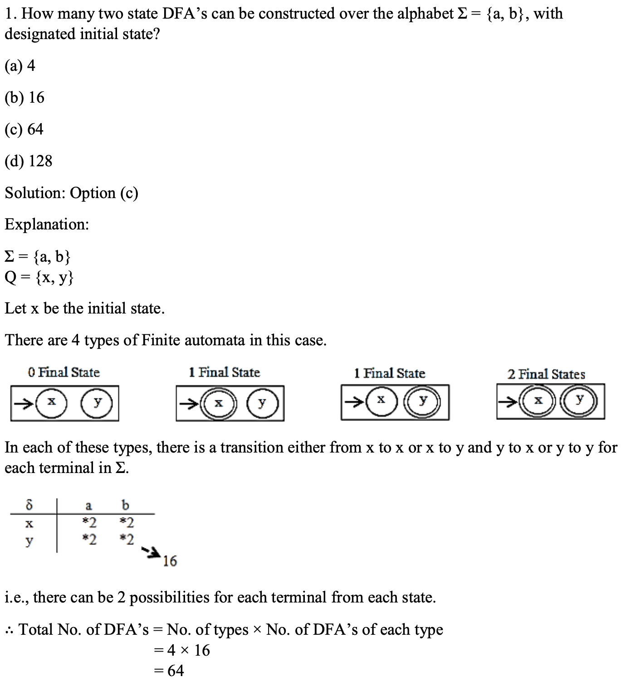

# 

## 
1. Trivial substring means a substring containing only one character.
> For any string, there will always be only 2 trivial substrings, ϵ and the given string itself. and the given string itself.

2. The total number of substrings present in “GATE” is:
> 11 (10 + epsilon)
(n(n+1)/2) +1

3. The `language of primes` in unary is {1^p | p is prime}. Finite automata cannot recognize this language as it has no memory. 
PDA also cannot recognize this as there is no pattern in the
strings that can be remembered using one stack. 
LBA can accept this, so it is a `context sensitive` language.
.
.

4. 
L1 = a^n.b^n (n ≥ 0)
L2 = Complement (L1)
> L1 & L2 are context free

5. A dead state 
- has two properties:
    1. It is a non-final (non-accepting) state.
    2. Once entered, the automaton can never reach an accepting state.

6. A Language is said to be regular iff 
(a) There exists a Right Linear Regular Grammar for L 
(b) There exists a Left Linear Regular Grammar for L 
(c) There exists a nfa with single final state 
(e) There exists a nfa without ԑ - move 

7. If L is Regular and R is not Regular and R is subset of L
- L ∪ R = L cz R is subset of L ===> L U R is Regular.
- R is not Regular

8. 
S1: LR = L, if and only if L is the language of palindromes. where LR is obtained by reversing all the strings of L.
S2: | L1 ∙ L2 | = | L1 | × | L2 |
- Both are False

9. Let r be any Regular Expression:
> r + ԑ = r = ԑ + r : FALSE

10. All co-finite languages are regular.

11. `Disambiguation` changes the grammar's structure, not the language it generates.

12. 
- ϕ^* = ∈
- a^* . ϕ = ϕ
- R+ϕ = R
- R . ∈ = R
- ∈^* = ∈

> ϕ : No string.
> ∈: One string of length zero.

13. How many DFA‟s?

- If m = no of symbols
and if n = no of states 
then No of types `wrt to final states` = 2^n.
No of DFA in each case = n^(m*n)
> Total DFA's = 2^n * n^(m*n) with designated initial state
> Total DFA's = 2^n * n^(m*n) * n with `NO designated initial state`

- 4. How many 2 state DFA‟s with designated initial state can be constructed over the alphabet
Σ = {a, b} that accept empty language ϕ ?
---- 20 
