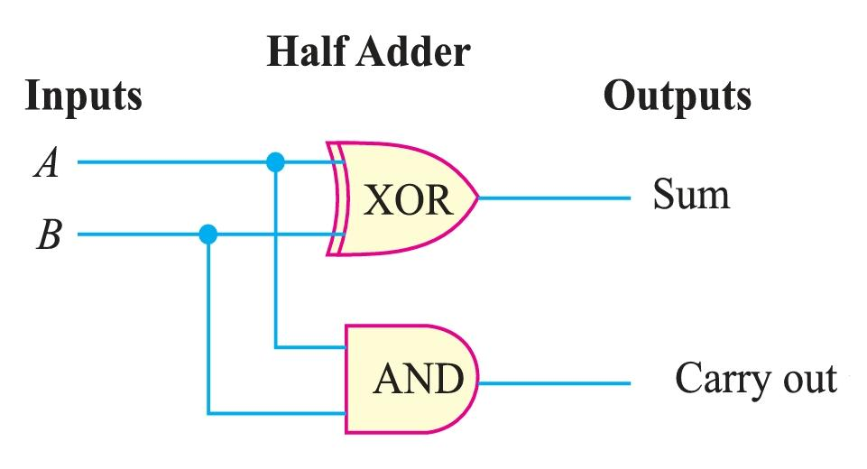
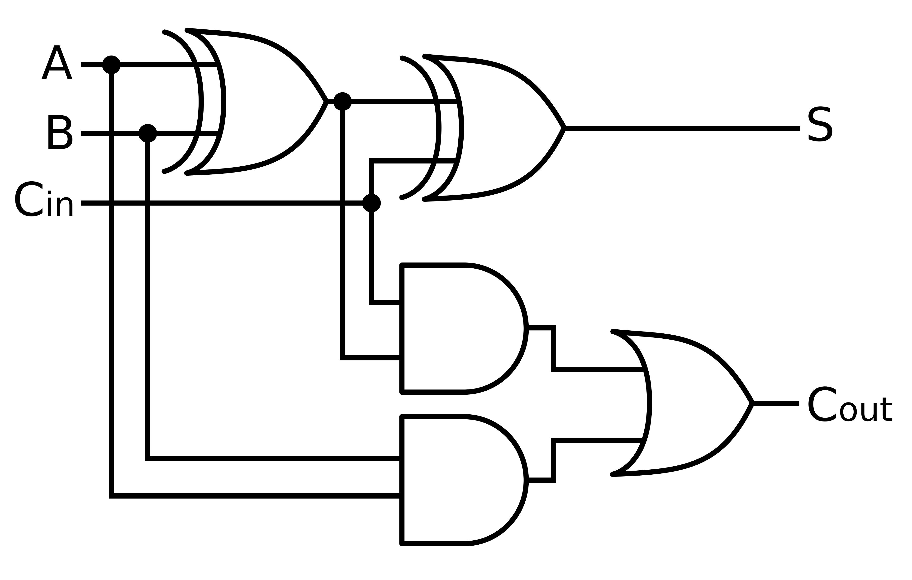
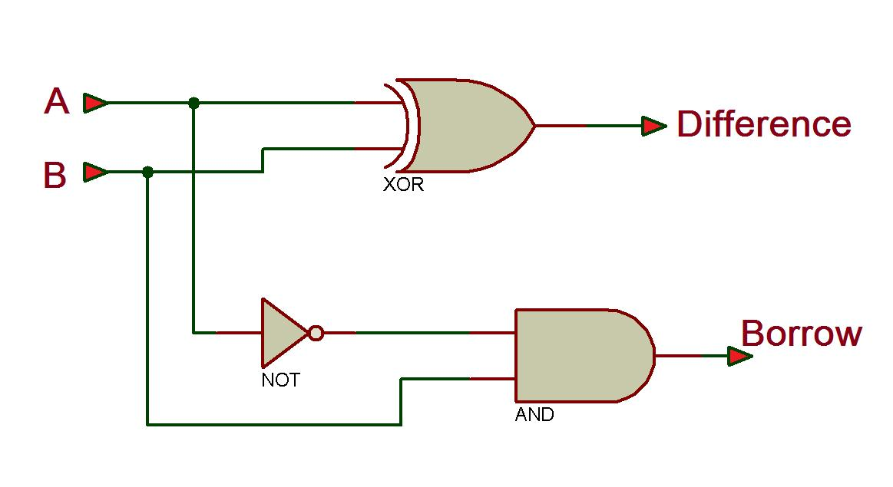

#

1. A Combinational Circuit is a digital logic circuit whose output depends only on the present inputs, not on previous inputs or past states.

## A Half Adder 
is a combinational logic circuit that adds two single-bit binary numbers and produces two outputs:
1. Sum (S): The result of addition.
2. Carry (C): The carry generated during addition.
- It is called a Half Adder because it can add only two input bits and does not accept a carry input from a previous stage.

## Full Adder
- A Full Adder is a combinational logic circuit that adds three single-bit binary inputs and produces two outputs:
1. Sum (S): Result of binary addition. = A xor B xor C
2. Carry-out (Cout): Carry generated from the addition.
    - If any 2 are 1's ie xy + yz +zx. or (x xor y).z + x.y
- Unlike a Half Adder, a Full Adder can accept a carry input from the previous stage.

- A standard Full Adder implementation requires:
XOR	2
AND	2
OR	1
Total	5

OR
> 2 Half Adders and 1 OR

- The Carry function of a Full Adder is also called:
C. Majority function

## Half Subtractor
- A Half Subtractor is a combinational logic circuit used to subtract one single-bit binary number from another single-bit binary number.
- It has two inputs and two outputs:
1. Difference (D): Result of subtraction. = A xor B
2. Borrow (Bout): Borrow generated when subtraction requires borrowing from the next higher bit. = ĀB
- Unlike a Full Subtractor, a Half Subtractor does not accept a borrow input from a previous stage.

