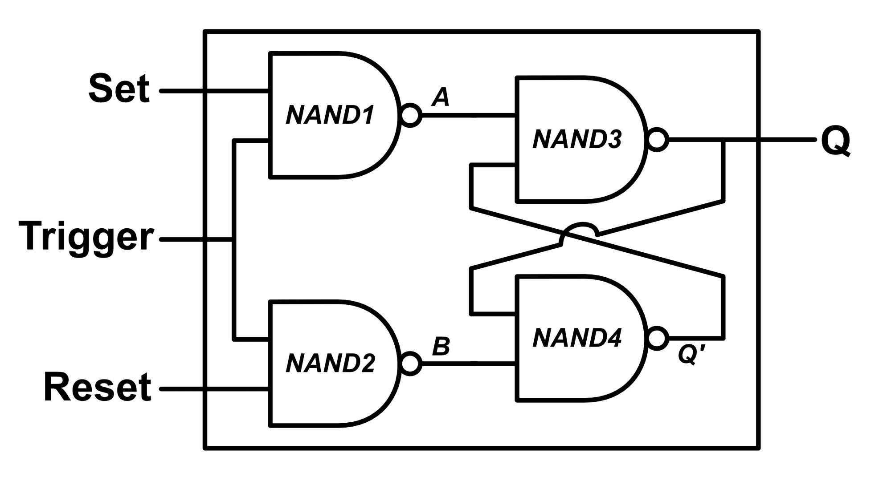
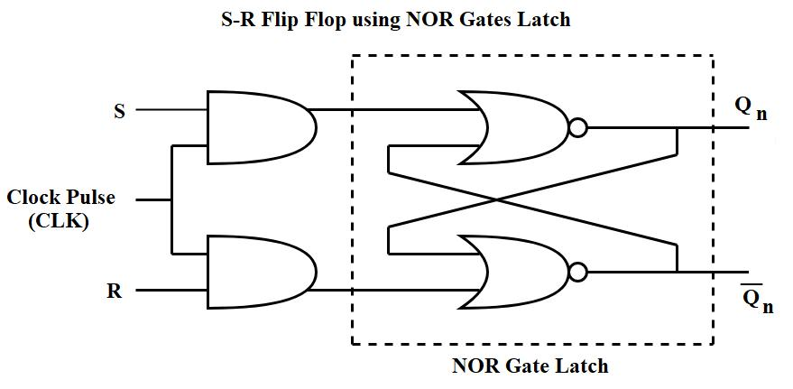
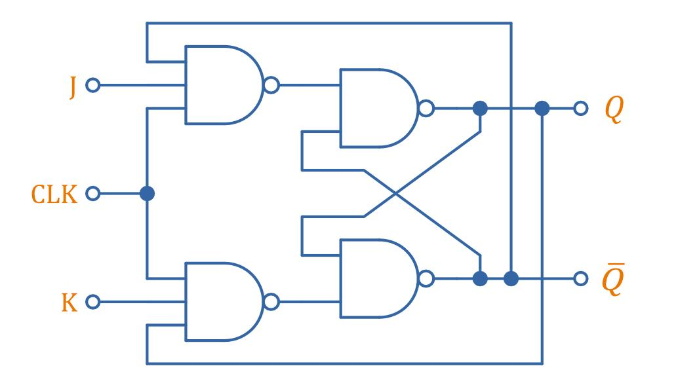
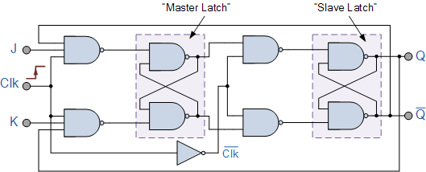
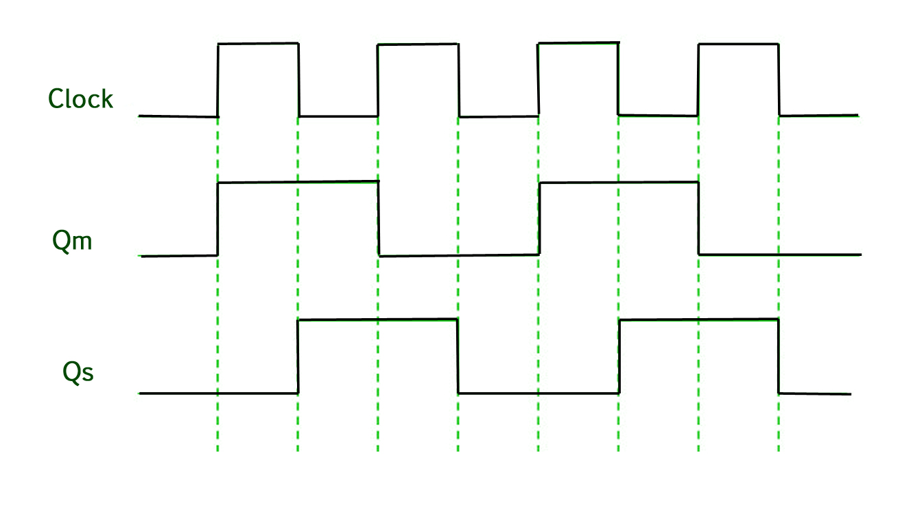
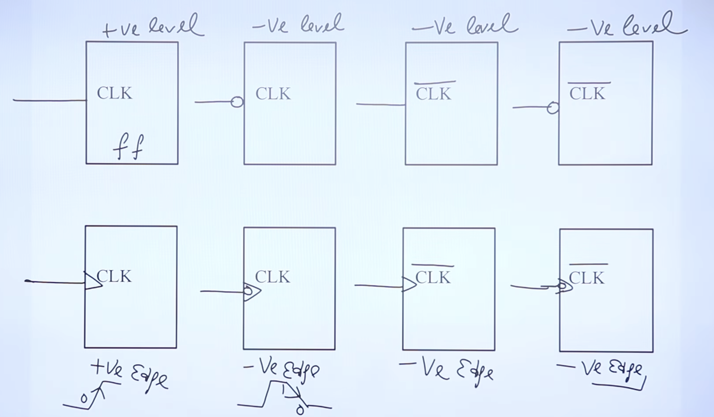
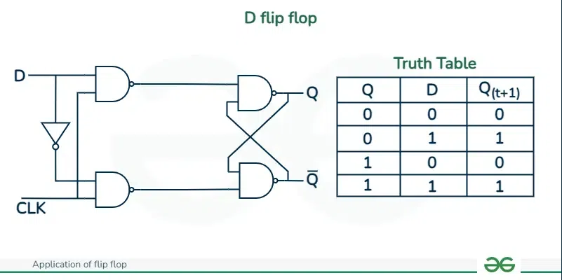
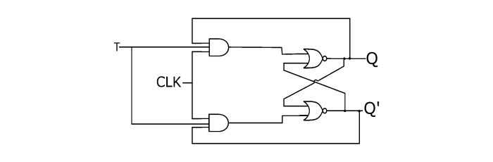

# sequential circuits

## Latch and Flip-flop
1. A `latch` is an asynchronous sequential logic circuit that stores a single bit of binary information (1 or 0) and retains it until new input signals update it.

2. A flip-flop is a bistable electronic circuit in digital electronics that can maintain one of two stable states (representing binary 0 or 1) and store a single bit of data. 
- Unlike simple latches, most flip-flops are edge-triggered, meaning they change their state only on the rising (positive) or falling (negative) transition of a clock pulse.

- Latch is level-sensitive.
    - Changes value instanatly.
- Flip-flop is edge-sensitive.
    - changes value only on Positive rising or negative falling  edge
- A flip-flop can be constructed using two appropriately connected latches (Master-Slave configuration).

## SR Latch 
- An SR Latch (Set-Reset Latch) is a basic memory element in Digital Electronics used to store 1 bit of information (0 or 1).
- It is a bistable circuit, meaning it has two stable states:
    - Q = 0 (RESET state)
    - Q = 1 (SET state)

1. SR Latch using NOR Gates
An SR Latch can be constructed using two cross-coupled NOR gates.

- Working:
    - Set (S = 1): Makes Q = 1.
    - Reset (R = 1): Makes Q = 0.
    - Both inputs 0: Retains previous state.
    - Both inputs 1: Invalid condition.

- Truth Table of NOR-based SR Latch
S	R	Q(next)	    Operation
0	0	Previous Q	Hold
0	1	0	        Reset
1	0	1	        Set
1	1	Invalid	    Forbidden

2. SR Latch using NAND Gates
An SR Latch can also be constructed using two cross-coupled NAND gates.

- Unlike the NOR latch, the NAND latch has active LOW inputs.

S̅	R̅	Q(next)	        Operation
1	1	Previous Q	    Hold
0	1	1	            Set
1	0	0	            Reset
0	0	Invalid	        Forbidden

- Important difference:
    - NOR SR Latch: Active HIGH inputs.
        - 1 0 ==> set
    - NAND SR Latch: Active LOW inputs.
        - 0 1 ==> set

## SR Flip Flop
- An SR Flip-Flop is a sequential logic circuit that stores 1 bit of information (0 or 1).
- It has two inputs:
    - S (Set): Makes the output Q = 1.
    - R (Reset): Makes the output Q = 0.
- Unlike an SR Latch, an SR Flip-Flop is edge-triggered, meaning its output changes only at a particular clock edge (rising or falling edge).
> Same truth tables whatever used.

- Truth Table of SR Flip-Flop
For a positive-edge-triggered SR Flip-Flop:

CLK	S	R	Q(next)	        Operation
↑	0	0	Q(previous)	    Hold
↑	0	1	0	            Reset
↑	1	0	1	            Set
↑	1	1	Invalid	        Forbidden
No active edge	X	X	    Q(previous)	Hold

- Characteristic equation:
Q^+=S+R'Q

1. SR Flip-Flop Using NAND Gates

> Same table as SR Latch using NOR.

2. SR Flip-Flop Using NOR Gates

> Same table as SR Flip-Flop using NAND.

- AND gates used first else clock wont work if NOR gates used.

### Characteristic Equation and Excitation Table
1. Characteristic Equation:
> Q(t+1) = S + R` . Q(t) 
- To make  Characteristic Table we use S , R , Qn => Qn+1
and derive Characteristic Equation

2. Excitation Table : 
An Excitation Table tells us what inputs must be applied to a flip-flop to achieve a desired transition from the present state to the next state.
- In simple words:
    - Characteristic Table: Inputs are given → Find the next state.
    - Excitation Table: Present and next states are given → Find the required inputs.

## JK Flip Flop
- A JK Flip-Flop is a sequential logic circuit that stores 1 bit of information. It is an improved version of the SR Flip-Flop because it eliminates the invalid state.
It has two inputs:
- J (Set): Used to set the output to 1.
- K (Reset): Used to reset the output to 0.

2. Truth Table of JK Flip-Flop
- For a positive-edge-triggered JK Flip-Flop:

Clock	J	K	Q(t+1)	    Operation
↑	    0	0	Q(t)	    Hold
↑	    0	1	0	        Reset
↑	    1	0	1	        Set
↑	    1	1	Q̅(t)	     Toggle

5. Characteristic Equation
> Q(t+1) = J.Q'(t) + K'.Q(t)

### Race Around Condition (JK Flip-Flop)
Race Around Condition is a problem that occurs in a 
1. level-triggered JK Flip-Flop when 
2. both inputs are HIGH (J = K = 1) and 
3. the clock pulse remains active for a duration longer than the propagation delay.
- As a result, the output toggles repeatedly between 0 and 1 during a single clock pulse, making the final output unpredictable.

### 4. Methods to Eliminate Race Around Condition

1. Method 1: Master-Slave JK Flip-Flop
- It consists of two latches:
    - Master
    - Slave
- Working:

Clock	Master	         Slave
---
HIGH	Active           Inactive
LOW	    Inactive	     Active

## Triggers 

## D Flip Flop 
A D Flip-Flop is a sequential logic circuit that stores 1 bit of information.
- It has only one input called D (Data) and a clock input (CLK).
- The next output state is always equal to the input D at the active clock edge.
> Q(t+1)=D

## T Flip-Flop (Toggle Flip-Flop)
A T Flip-Flop is a sequential logic circuit that stores 1 bit of information. It is called a Toggle Flip-Flop because it changes (toggles) its output whenever the input T = 1 at the active clock edge.

- The most important concept is:
    - T = 0 → Output remains unchanged (Hold).
    - T = 1 → Output changes to its complement (Toggle).

# Conversions 

1. SR to D

2. T flip flop to JK flip flop

