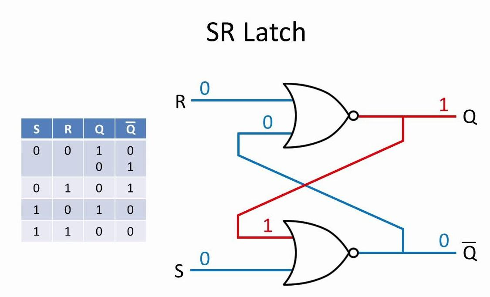
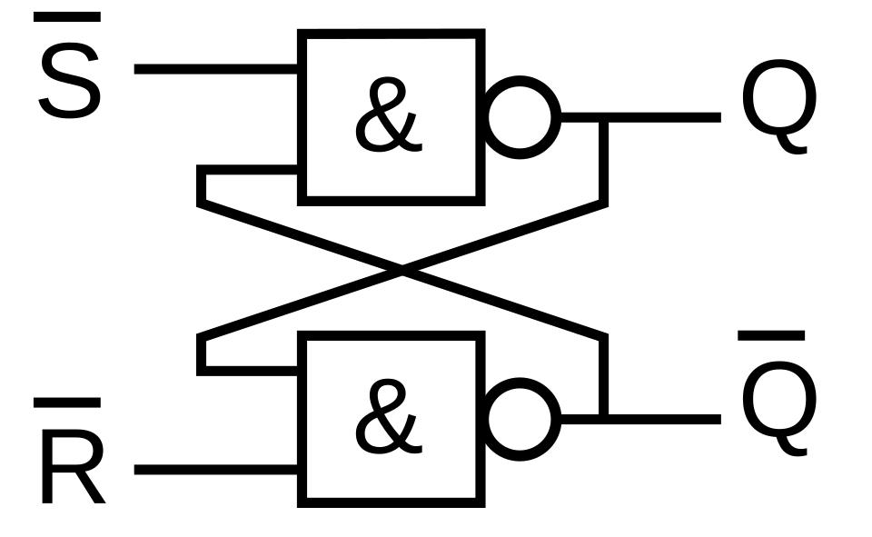

# sequential circuits

## Latch and Flip-flop
1. A `latch` is an asynchronous sequential logic circuit that stores a single bit of binary information (1 or 0) and retains it until new input signals update it.

2. A flip-flop is a bistable electronic circuit in digital electronics that can maintain one of two stable states (representing binary 0 or 1) and store a single bit of data. 
- Unlike simple latches, most flip-flops are edge-triggered, meaning they change their state only on the rising (positive) or falling (negative) transition of a clock pulse.

- Latch is level-sensitive.
- Flip-flop is edge-sensitive.
- A flip-flop can be constructed using two appropriately connected latches (Master-Slave configuration).

## SR Latch 
- An SR Latch (Set-Reset Latch) is a basic memory element in Digital Electronics used to store 1 bit of information (0 or 1).
- It is a bistable circuit, meaning it has two stable states:
    - Q = 0 (RESET state)
    - Q = 1 (SET state)

1. SR Latch using NOR Gates
An SR Latch can be constructed using two cross-coupled NOR gates.

- Working:
    - Set (S = 1): Makes Q = 1.
    - Reset (R = 1): Makes Q = 0.
    - Both inputs 0: Retains previous state.
    - Both inputs 1: Invalid condition.

- Truth Table of NOR-based SR Latch
S	R	Q(next)	    Operation
0	0	Previous Q	Hold
0	1	0	        Reset
1	0	1	        Set
1	1	Invalid	    Forbidden

2. SR Latch using NAND Gates
An SR Latch can also be constructed using two cross-coupled NAND gates.

- Unlike the NOR latch, the NAND latch has active LOW inputs.

S̅	R̅	Q(next)	        Operation
1	1	Previous Q	    Hold
0	1	1	            Set
1	0	0	            Reset
0	0	Invalid	        Forbidden

- Important difference:
    - NOR SR Latch: Active HIGH inputs.
        - 1 0 ==> set
    - NAND SR Latch: Active LOW inputs.
        - 0 1 ==> set

