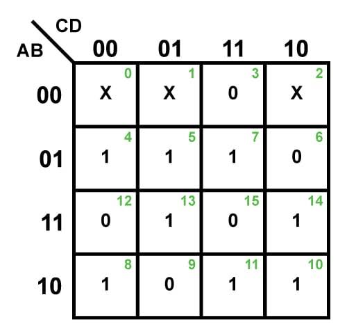
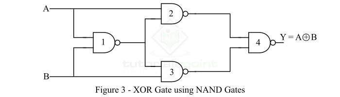
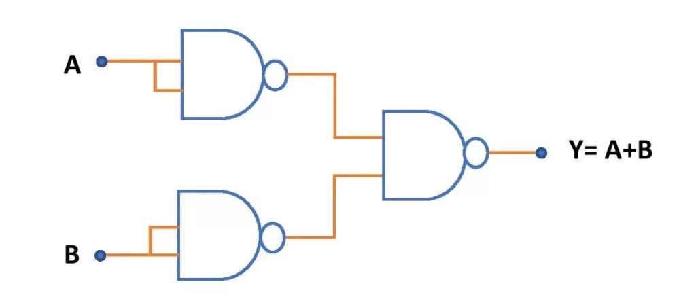
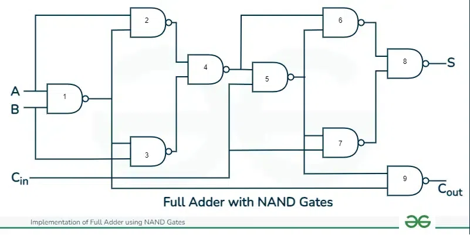
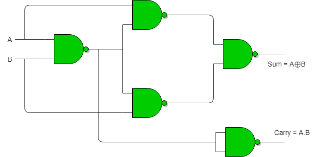

# 

## Logic Gates
Logic gates are the basic building blocks of digital circuits. They perform logical operations on one or more binary inputs (0 or 1) to produce a single binary output.

1. Basic Logic Gates
    1. A. AND Gate : Y=A.B

    2. B. OR Gate : Y=A+B

    3. NOT Gate : Y= Ā

2. Universal Logic Gates
- Universal gates can implement any Boolean function using only that type of gate.
    1. NAND Gate
        ___
    Y= {A.B}
    > Opposite of AND gate.

    2. NOR Gate
        ___
    Y= {A+B}

    > Opposite of OR gate.

3. Special or Arthimetic Logic Gates
    1. XOR (Exclusive OR)
    > Y=ĀB + B`A
    - Output is 1 when inputs are different.

    2. XNOR (Exclusive NOR)
        ______
    Y =  A xor B
    > Y=AB + ĀB`
    - Output is 1 when inputs are the same.

## Important Boolean Identities
1. Identity : 
A operation `what` = A.

2. Null 
A operation `what` = NULL.

3. Idempotent
if A operation A = A

4. Complement
- OR Complement Property : A + A` = 1
- AND Complement Property : A.A`=0

5. Involution
A Double Complement = A.

6. De Morgan's 1
```yml
 (A+B)` = A` . B`
```

7. De Morgan's 1
```yml
 (A.B)` = A` + B`
```

Gate	Commutative	    Associative
AND	    Yes	            Yes
OR	    Yes	            Yes
XOR	    Yes	            Yes
NAND	Yes	            No
NOR	    Yes	            No
XNOR	Yes	            No
NOT	    N/A	            N/A

## Canonical Sum of Product (SOP)
Canonical Sum of Products (SOP) is a standard form of representing a Boolean function in which each product term contains all the input variables exactly once, either in complemented or uncomplemented form.
- It is also called the Sum of Minterms.

1. Sigma notation
Instead of writing all minterms, we can use:
F(A,B)=Sigma m(1,2,3)

- Canonical SOP → Select rows where F = 1 → Minterms.
- Canonical POS → Select rows where F = 0 → Maxterms.


## Duality Theorem
- The Duality Theorem states that:
If a Boolean expression is valid, its dual expression is also valid.

The dual is obtained by interchanging:
1. OR (+) ↔ AND (·)
2. 0 ↔ 1
Variables and their complements remain unchanged.

- Important: Complement operation is NOT interchanged.

## De Morgan's laws:
```yml
____
A+B = A`. B`
____
A`.B` = A`+ B`

```

## Self Dual Function
- A Self-Dual Function is a Boolean function whose dual is equal to the original function.
1. Self-dual condition:
f(bar X)=bar{f(X)}

2. Number of self-dual functions:
> 2^{2^{n-1}}


## K-Map Minimization
- A Karnaugh Map (K-Map) is a graphical method used to simplify Boolean expressions and minimize logic circuits.
It helps us obtain the simplest possible Boolean expression by grouping adjacent 1s or 0s.
- Main objective: Reduce the number of:
    - Logic gates.
    - Variables in each term.
    - Literal occurrences.
    - Circuit complexity.


1. In a 4-variable K-Map, a group of 8 cells eliminates how many variables?
C. 3

2. A group of 4 cells in a 5-variable K-Map leaves how many variables?
A. 3
- 5 − log₂4 = 5 − 2 = 3 variables.

### Gray Code
- Gray Code is a binary number system in which two consecutive numbers differ in exactly one bit.
- It is also called Reflected Binary Code.
 
# GATES  USING NAND : 

## XOR Gate using NAND :
- An XOR gate can be implemented using `4` NAND gates.



## OR Gate Using NAND Gates
An OR gate can be implemented using `3` NAND gates.


## AND gate using NAND
- `2` NAND gates

## NOT Gate Using NAND Gate
A NOT gate can be implemented using just `1` NAND gate.

## Full Adder using NAND :
9


## Half Adder using NAND :
5


## Both HALF and FULL Adder Simultameouly :
- First HA is common to both ===> 9+5 - 4 = 10 NAND's.


