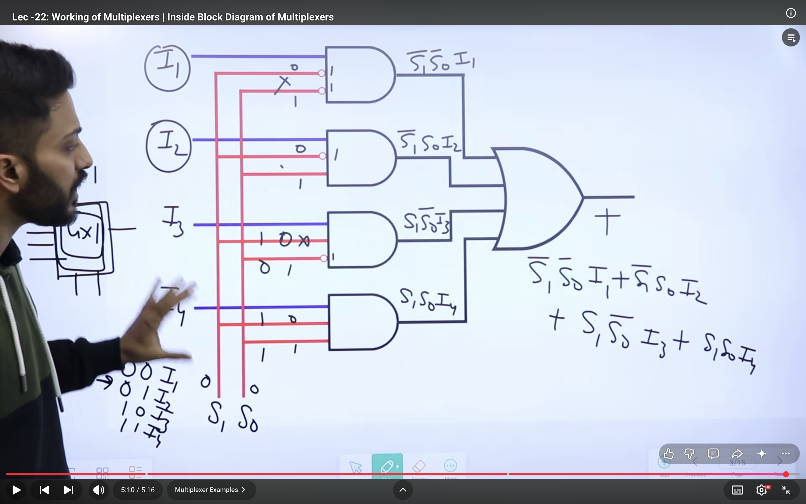
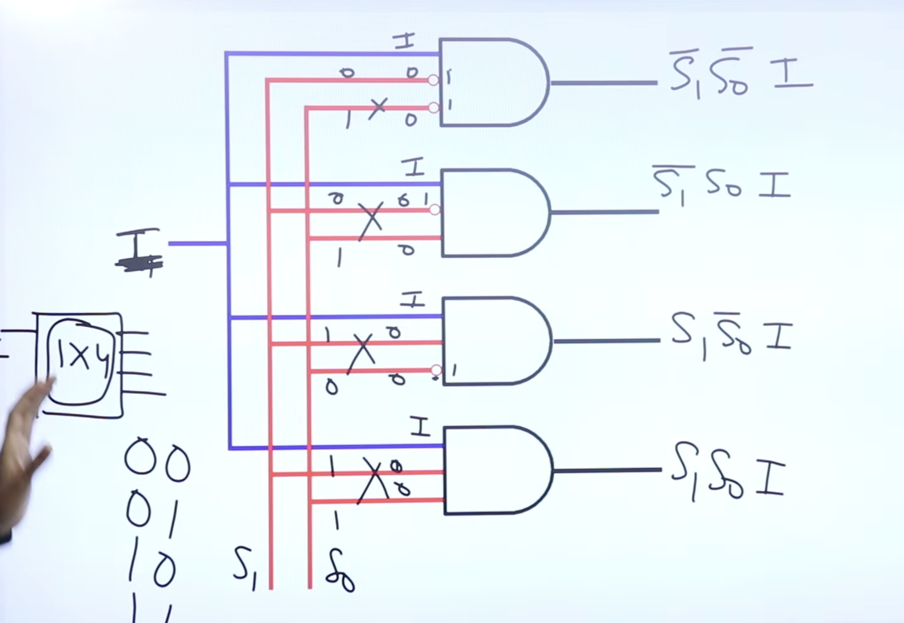
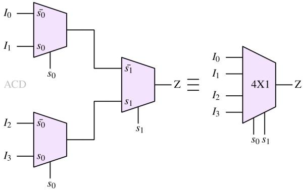
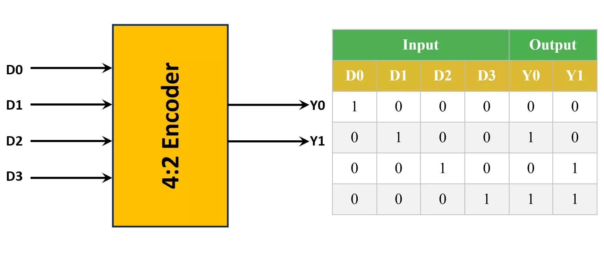
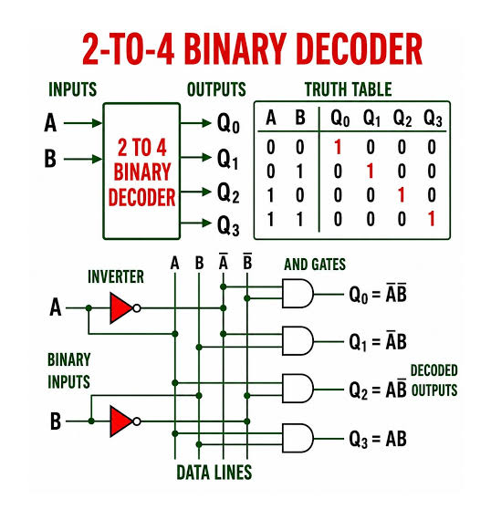

#

## Multiplexer
A Multiplexer (MUX) is a combinational logic circuit that selects one input from multiple input lines and forwards it to a single output line.
- It is also called a Data Selector.
- In simple words, a MUX works like a switch: depending on the selection lines, it decides which input should reach the output.
- A MUX has three important components:
    - Data inputs: Inputs from which data is selected.
    - Selection lines: Decide which input is selected.
    - Output: Carries the selected input.

2. Important Formula
For a Multiplexer having \(2^n\) input lines:
- Number of selection lines = n
And:
- Number of inputs=2^n

### 4:1 Multiplexer
- A 4:1 MUX has:
    - 4 data inputs: I_0,I_1,I_2,I_3
    - 2 selection lines: S_1,S_0
    - 1 output: Y

- Boolean Expression
> Y = S1'.S2'.I0 + S1'.S2.I1 + S1.S2'.I2 + S1.S2.I3 
The binary value of the selection lines indicates the selected input number.

- To construct a 2^n:1 MUX using 2:1 MUXes:
> Number of 2:1 MUXes =2^n-1

> Multiplexers are Functionally complete.
- AND , OR and NOR can be made ==> All can be.

1. Inside working of Multplixer:

## Demultiplexers
- A Demultiplexer (DEMUX) is a combinational logic circuit that takes one input and distributes it to one of several output lines, depending on the selection lines.
- It is also called a Data Distributor.
- In simple words:
    - MUX selects one input from many inputs and sends it to one output.
    - DEMUX takes one input and sends it to one selected output.
- A DEMUX has three components:
    - Data input (D): The single input signal.
    - Selection lines (S): Decide which output receives the input.
    - Output lines (Y): Multiple output lines.

1. Inside working of DeMultplixer:

> Neither MUX nor DeMUX is universally a universal circuit by itself. 
- However, a MUX can be used as a universal logic element under suitable input connections.
> MUX is a universal logic circuit.

## Cascading Multiplexer
- Cascading multiplexers means connecting multiple smaller MUXes together to construct a larger MUX.

### Why do we cascade multiplexers?
Suppose we have only 2:1 MUXes, but we need to construct a 4:1 MUX.
- A 4:1 MUX has:
    - 4 data inputs: \(I_0,I_1,I_2,I_3\)
    - 2 select lines: \(S_1,S_0\)
    - 1 output: \(Y\)
- We can construct it using `three` 2:1 MUXes.

-  Number of 2:1 MUXes required
    - To construct an \(N:1\) MUX using 2:1 MUXes:
    > Number of MUXes=N-1
- Number of stages (levels)
    - For a \(2^n:1\) MUX constructed using 2:1 MUXes:
    > Number of stages=n=\log_2 N

## Encoder and Decoder :
- Encoder and Decoder are combinational logic circuits that perform opposite operations in digital systems.
    - Encoder: Converts an active input line into a binary code.
    - Decoder: Converts a binary code into a corresponding active output line.

1. Encoder
- An Encoder is a combinational circuit that converts \(2^n\) input lines into an n-bit binary output.
> Number of output lines = log_2{Number of input lines}

-  4:2 Binary Encoder
    A 4:2 Encoder has:
    - 4 input lines: \(D_0,D_1,D_2,D_3\)
    - 2 output lines: \(Y_1,Y_0\)

1. If D_0=1, output = 00.
2. If D_1=1, output = 01.
3. If D_2=1, output = 10.
4. If D_3=1, output = 11.

2. Decoder

