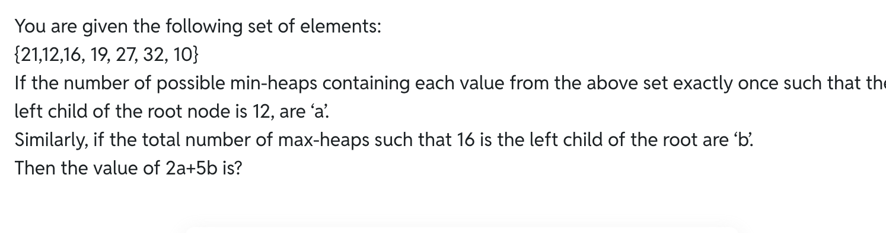

#

## EXTRAS

1. An array of 25 distinct elements is to be sorted using quicksort. Assume that the pivot element is chosen uniformly at random. The probability that the pivot element gets placed in the worst possible location in the first round of partitioning (rounded off to 2 decimal places) is ________.

> P = 2 / 25 = 0.08

