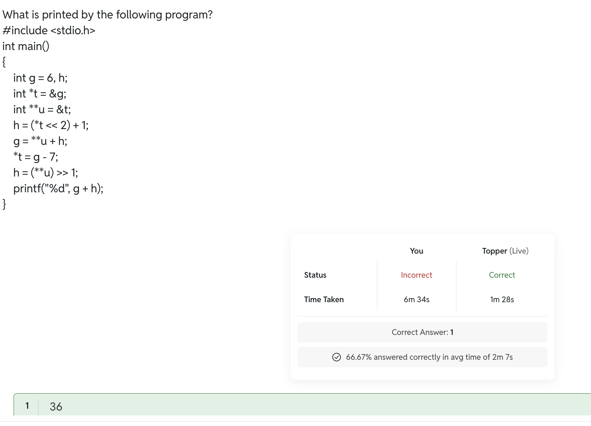
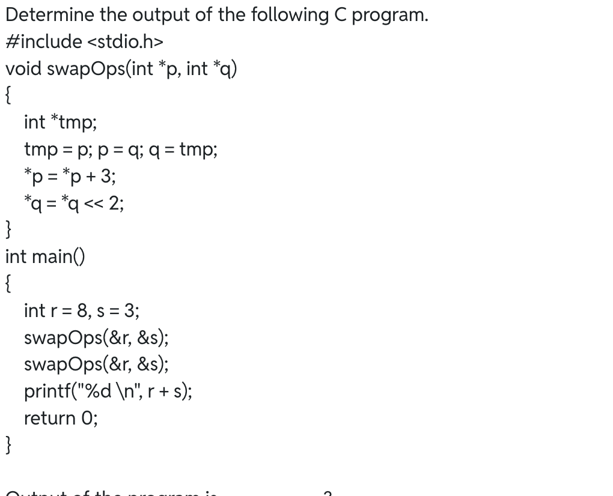
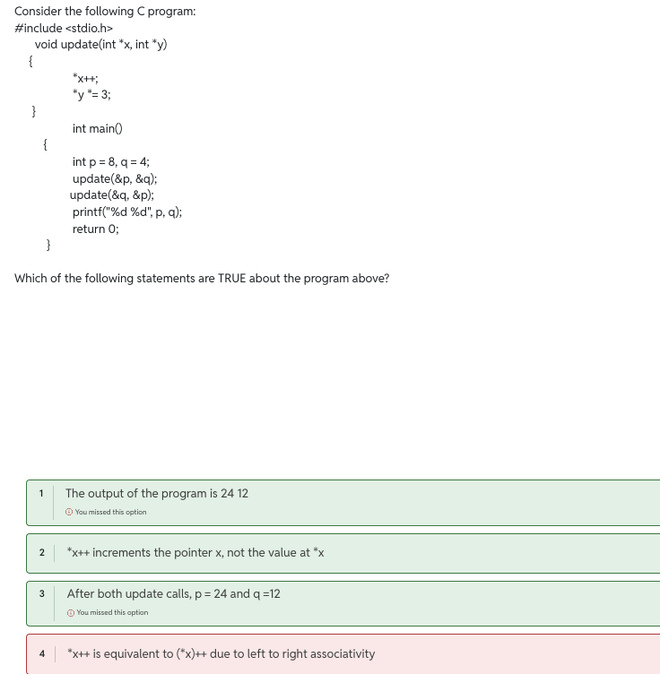

#

## 
> 2^16 = 32768.

> C standard doesnt specify the sizes of data types rather compiler does.

> In case of short , signed as well as int is optional for declaration.

## Test series pw C Prog :
1. Yes, you can use a negative number as the first operand of the modulo operator (%) in C.

2. - A static local variable retains its value between function calls.
- A static variable can still be overwritten by an assignment.
- C passes function arguments by value.

3. grid[i][j] = *(*(grid + i) + j);
| Expression              | Meaning                         |
| `grid`                  | Pointer to the first row        |
| `*grid`                 | First row of the array          |
| `**grid`                | Value of the first element: `2` |
| `grid + 1`              | Pointer to the second row       |
| `*(grid + 1)`           | Second row of the array         |
| `*(*(grid + i) + j)`    | Element at row `i`, column `j`  |
| `*(grid + i)` | Row `i` |

4. The no. of possible binary trees with 3 nodes are:
> catalan’s number
> (2n)_C_n / ( n+1)

5. In Data Structures (Trees and Graphs), the 
`degree` of a node means the number of children (or direct descendants) of that node.
- Let:
- n_0 = Number of nodes having degree 0 (leaf nodes).
- n_1 = Number of nodes having degree 1.
- n_2 = Number of nodes having degree 2.
- For any non-empty binary tree:
Number of edges=Number of nodes-1
Therefore,
> n_1 + 2*n_2=  n_0 + n_1 + n_2 - 1
> n_2 = n_0 - 1.

6. AVL Tree (Adelson-Velsky and Landis Tree)
- An AVL Tree is a self-balancing Binary Search Tree (BST) in which the height difference between the left and right subtrees of every node is at most 1.

- Four Types of Rotations
- When insertion or deletion makes an AVL tree unbalanced, rotations restore balance.
    1. A. LL (Left-Left) Rotation
    Occurs when a node is inserted into the left subtree of the left child.
    - Solution: Single Right Rotation.

    2. B. RR (Right-Right) Rotation
    Occurs when a node is inserted into the right subtree of the right child.
    - Solution: Single Left Rotation.

    3. C. LR (Left-Right) Rotation
    Occurs when a node is inserted into the right subtree of the left child.
    - Solution: Double Rotation.
        - Left rotation on the left child.
        - Right rotation on the unbalanced node.

    4. D. RL (Right-Left) Rotation
    Occurs when a node is inserted into the left subtree of the right child.
    - Solution: Double Rotation.
        -  Right rotation on the right child.
        -  Left rotation on the unbalanced node.

7. Postorder traversal of a given BST is sorted order of elements of a BST. 

8. Which of the following pair of traversals is not sufficient to build a binary tree from the given
traversals?
(b) Preorder and Postorder
> Inorder is Required.

## RE ATTEMPT 

