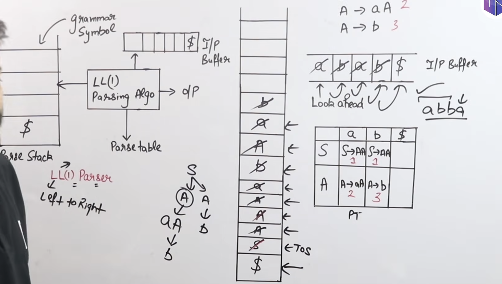

# Parsers

## LL1 PARSER :
An LL(1) Parser is a `top-down` predictive parser that reads input from left to right and produces a `leftmost derivation` using one lookahead symbol.
1. First L	: Left-to-right scanning of input
2. Second L	: Leftmost derivation
3. 1	: One lookahead symbol

- Important: LL(1) is a non-backtracking predictive parser.

### 5. Construction of LL(1) Parsing Table
1. Build First and Follown of symbols.
2. Fill table
    - Prod rule no. is put into the first of its RHS.
    - if RHS is epsilon then its put into Follow of LHS.

- If any entry of parse table has multiple entries then its not LL1.

> to check if a grammer is LL1 , Calaculate intersection of FIRST all terms on RHS and Follow of LHS if epsilon is there.

### Working;
- An LL(1) parser works using three main components:
    1. Input Buffer – Stores the input string.
    2. Stack – Stores grammar symbols and the end marker $.
    3. Parsing Table – Determines which production rule to apply.

1. Initial configuration:
- Stack: $S (S is the start symbol)
- Input: w$ (w is the input string)

2. At every step, consider:
- X = Top symbol of stack.
- a = Current input symbol (lookahead).

    1. Case 1: X is a terminal and X = a
    Pop X from stack.
    Move input pointer to the next symbol.

    2. Case 2: X is a non-terminal
    - Look up parsing table entry M[X, a].
    - If M[X,a] contains X → YZ, pop X and push ZY onto the stack (`reverse order`). ie first Y then Z.
    - If the production is X → ε, simply pop X.

    3. Case 3: X = a = $
    Accept
    Both stack and input have reached their end markers. The input string is accepted.

    4. Case 4: Error
    Error
    If:
    - A terminal does not match the input symbol, or
    - The parsing table entry is empty,
    then a parsing error is reported.

## LR(0) PARSER 

