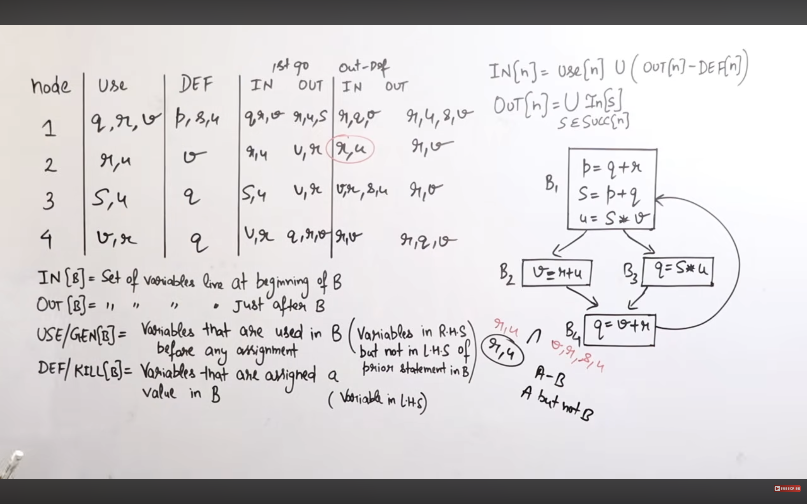

# Parsers

## LL1 PARSER :
An LL(1) Parser is a `top-down` predictive parser that reads input from left to right and produces a `leftmost derivation` using one lookahead symbol.
1. First L	: Left-to-right scanning of input
2. Second L	: Leftmost derivation
3. 1	: One lookahead symbol

- Important: LL(1) is a non-backtracking predictive parser.

### 5. Construction of LL(1) Parsing Table
1. Build First and Follown of symbols.
2. Fill table
    - Prod rule no. is put into the first of its RHS.
    - if RHS is epsilon then its put into Follow of LHS.

- If any entry of parse table has multiple entries then its not LL1.

> to check if a grammer is LL1 , Calaculate intersection of FIRST all terms on RHS and Follow of LHS if epsilon is there.

### Working;
- An LL(1) parser works using three main components:
    1. Input Buffer – Stores the input string.
    2. Stack – Stores grammar symbols and the end marker $.
    3. Parsing Table – Determines which production rule to apply.

1. Initial configuration:
- Stack: $S (S is the start symbol)
- Input: w$ (w is the input string)

2. At every step, consider:
- X = Top symbol of stack.
- a = Current input symbol (lookahead).

    1. Case 1: X is a terminal and X = a
    Pop X from stack.
    Move input pointer to the next symbol.

    2. Case 2: X is a non-terminal
    - Look up parsing table entry M[X, a].
    - If M[X,a] contains X → YZ, pop X and push ZY onto the stack (`reverse order`). ie first Y then Z.
    - If the production is X → ε, simply pop X.

    3. Case 3: X = a = $
    Accept
    Both stack and input have reached their end markers. The input string is accepted.

    4. Case 4: Error
    Error
    If:
    - A terminal does not match the input symbol, or
    - The parsing table entry is empty,
    then a parsing error is reported.

## LR(0) PARSER 
- LR(0) is a `bottom-up parser` that reads input from Left to right and constructs a Rightmost derivation in reverse, using zero lookahead symbols.

1. What does LR(0) mean?
- L	Left-to-right scanning of input
- R	Rightmost derivation in reverse
- 0	Zero lookahead symbols

### The LR(0) parsing table contains two sections:
1. ACTION – For terminals and $.
2. GOTO – For non-terminals.

- Rules for ACTION and GOTO
1. Dot before terminal a	=>   ACTION[I, a] = Shift
2. Dot before non-terminal A		=>   GOTO[I, A] = State
3. S'--> S.	=>   	Accept
4. A - > alpha.dot	 ===> Reduce by A - > alpha on ALL terminals and $

> If There is no multiple-entry conflict in this parsing table. themn grammer is LR0.

## SLR (1)
Simple LR Parser
- It is a bottom-up, shift-reduce parser that uses LR(0) items and FOLLOW sets to construct its parsing table.
1. What does SLR(1) mean?
- S	Simple
- L	Left-to-right scanning of input
- R	Rightmost derivation in reverse
- 1	One lookahead symbol

2. SLR(1) uses:
- LR(0) items to construct states.
- FOLLOW sets to determine reduction entries.
- ACTION and GOTO tables to parse input.

3. Diff :
    1. In LR(0):
    - Reduce by A -> alpha on ALL terminals and $.

    2. In SLR(1):
    Reduce by A -> alpha only on terminals belonging to:
    FOLLOW(A)

## CLR Parsing Table 
- LR(1) Canonical Items
CLR(1) = Canonical LR(1) is the most powerful standard LR parsing technique. It uses LR(1) items, where every item contains one lookahead symbol.
- Unlike SLR(1), CLR(1) uses item-specific lookaheads instead of the global FOLLOW set.
> Next lookahead is first of Following Terms after Terminal.

## LALR
- LALR(1) is a bottom-up parsing technique that combines the advantages of CLR(1) and the smaller parsing table of SLR(1).
- Main idea: Merge CLR(1) states having identical LR(0) cores by combining their lookahead symbols.
    - Ignore the lookahead symbols and compare the LR(0) cores.
    - Merging CLR(1) states can introduce reduce-reduce conflicts. ==> CLR 

| Parameter | LR(0) | SLR(1) | LALR(1) | CLR(1) |
|---|---|---|---|---|
| Item type | LR(0) | LR(0) | LR(1) | LR(1) |
| Lookahead in items | No | No | Yes | Yes |
| Reduction basis | All terminals | FOLLOW | Item lookahead | Item lookahead |
| State construction | LR(0) | LR(0) | Merged CLR | Canonical LR |
| Table size | Small | Small | Medium | Large |
| Power | Lowest | ↑ | ↑ | Highest |

- Merge similar states , if no RR or SR conflict then LALR

