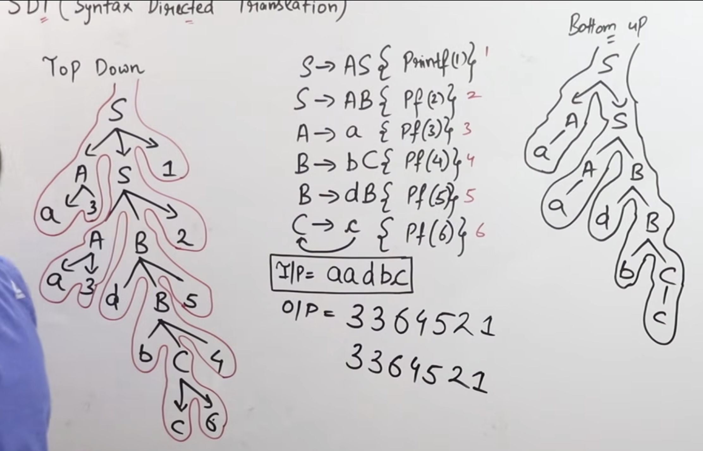

# Semantic Analysis
- Semantic Analysis is the third phase of a compiler. It checks whether a program is meaningful according to the language's semantic rules.
- It takes the output of Syntax Analysis (Parse Tree / AST) and checks for semantic errors.

## 1. Main Functions of Semantic Analysis
1. Type Checking: Checks whether data types are compatible.

2. Type Conversion: Handles valid implicit or explicit type conversions.

3. Declaration Checking: Checks whether variables and functions are declared before use (according to language rules).

4. Scope Checking: Checks whether a variable is accessed within its valid scope.

5. Function Checking: Checks function arguments, number of parameters and return types.

6. Symbol Table Management: Uses the symbol table to store information about identifiers, their types, scope and other attributes.

7. Execute Arthimetic Operations.

## 4. Syntax-Directed Translation (SDT / SDD)
- Semantic analysis uses semantic rules and attributes.

- Two important types of attributes:
1. Synthesized Attribute	
- Information flows from `child to parent`
- Bottom-up	
- Used in S-attributed definitions
    - S-attributed SDD uses only Synthesized Attributes.

2. Inherited Attribute
- Information flows from `parent or siblings`
- Downward / left-to-right
- Used in L-attributed definitions
    - L-attributed SDD allows both Synthesized and Inherited Attributes, subject to certain restrictions.
    - Information can flow from parent to child.
    - Information can flow from left sibling to right sibling.

### Top Down vs Bottom Up SDT :

### Evaluate Arithmetic Expression 
- Below Rules have more priority so calculate those first then upper.
else make parse tree and evaluate using bottom or top parsing.

## 