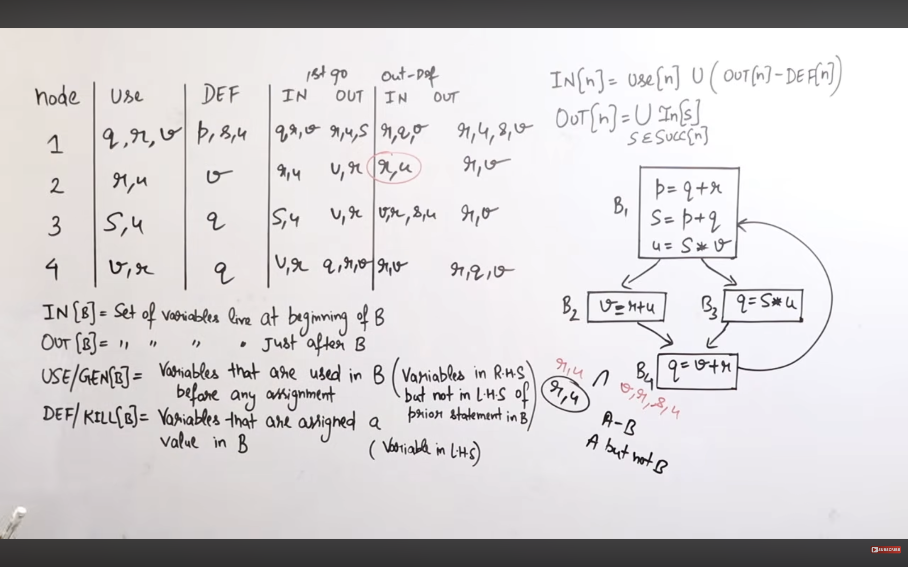

# Code Optimization

## 1. Types of Code Optimization
Code optimization is broadly classified into:

1. Machine Independent
- Optimization performed without considering the specific target machine or its architecture.
    1. Constant Folding
    Evaluating constant expressions at compile time instead of runtime.

    2. Constant Propagation
    Replacing variables with their known constant values.

    3. Common Subexpression Elimination (CSE)
    If the same expression is calculated multiple times and its operands have not changed, calculate it only once.

    4. Dead Code Elimination
    Removing statements that do not affect the program's final output or observable behaviour.

    5. Copy Propagation
    Replacing a variable with another variable to which it has been assigned.

    6. Loop Optimization
    Optimizing operations inside loops to reduce repeated computation.
    - Important subtypes:
        1. A. Loop-Invariant Code Motion
        Move computations that do not change inside a loop to outside it.
        2. Strength Reduction
        - Replace an expensive operation with a cheaper equivalent operation.
        3. C. Loop Unrolling
        Reduce loop overhead by executing multiple iterations in one loop body.

2. Machine Dependent
- Optimization performed by considering the target machine's architecture, instruction set, registers, and memory.
    1. Register Allocation
    Assign frequently used variables to CPU registers to reduce memory access.
    2. Register Assignment
    Choose specific registers for storing variables and intermediate results.
    3. Instruction Selection
    Choose efficient machine instructions for implementing operations.
    4. Instruction Scheduling
    Reorder instructions to improve CPU pipeline utilization while preserving dependencies.
    5. Peephole Optimization
    Examine a small sequence of consecutive machine instructions and replace it with a more efficient sequence.

## Peephole Optimization 
is a code optimization technique in which a small set of consecutive instructions is examined (called a peephole) and replaced with an equivalent but more efficient set of instructions.
- It is generally performed during Target Code Optimization.
- Machine Depenedent 

1. Main Objective
- Reduce the number of instructions.
- Reduce execution time.
- Reduce code size.
- Improve program efficiency.
- Preserve the original program's meaning.

## 2. Types of Peephole Optimization
1. Redundant Instructions Elimination
Removes unnecessary instructions.

2. Redundant Load and Store Elimination
Removes unnecessary memory operations.

3. Algebraic Simplification
- Simplifies mathematical expressions.
x = x + 0	x = x
x = x * 1	x = x
x = x * 2	x = x + x
x = x - 0	x = x

4. Constant Folding
Evaluates constant expressions at compile time.

5. Strength Reduction
Replaces expensive operations with cheaper operations.

6. Flow of Control Optimization
Removes unnecessary jumps.

7. Unreachable Code Elimination
Removes code that can never execute.

## Data Flow Analysis (DFA) 
is a technique used in compiler optimization to collect information about how data (values of variables) flows through a program.
- Main purpose: To perform optimizations such as:
    - Dead Code Elimination
    - Common Subexpression Elimination
    - Constant Propagation
    - Live Variable Analysis
    - Reaching Definitions

### 2. Important Concepts
1. Basic Block
A sequence of consecutive statements with:
- One entry point.
- One exit point.
- No branching into the middle.
- No branching out except at the end.

2. Control Flow Graph (CFG)
A directed graph representing the flow of control between basic blocks.
- Nodes → Basic Blocks.
- Edges → Possible flow of control.

3. Four Important Data Flow Analyses
1. A. Reaching Definitions (RD)
A definition of a variable reaches a program point if there exists a path from that definition to that point without another definition of the same variable.

2. B. Live Variable Analysis (LVA)
A variable is live at a program point if its current value may be used in the future before being redefined.

3. C. Available Expressions (AE)
An expression is available at a program point if it has already been computed along every path to that point, and its operands have not changed since its computation.

4. D. Very Busy Expressions (VBE)
An expression is very busy at a program point if it will definitely be evaluated on every path from that point before any of its operands are redefined.

### 3. How to Identify Basic Blocks?
A statement is called a Leader if it satisfies any of these conditions:
1. The first statement of the program is a leader.
2. The target of a conditional or unconditional jump is a leader.
3. The statement immediately following a conditional or unconditional jump is a leader.

## Local vs Global Optimization 
1. Local Optimization: Optimization performed within a single Basic Block.
- Uses DAG for local optimization	
- Example: Constant folding , Local dead code elimination

2. Global Optimization: Optimization performed across multiple Basic Blocks, generally within a function or procedure.
- Uses data flow analysis
- Example: Global constant propagation , Global dead code elimination 

## Liveness Analysis in Code optimization
- Liveness Analysis is a Data Flow Analysis technique used to determine whether the value of a variable will be needed in the future.

1. USE[B]:
- Variables used in a basic block before being defined in that block.
- Also called upward-exposed uses.

2. DEF[B]:
- Variables assigned values in a basic block.

3. OUT Equation:
> OUT[B]=  (S ẽ Succ(B)) Ū IN[S]

4. N Equation:
> IN[B]= USE[B] Ū (OUT[B]-DEF[B])

