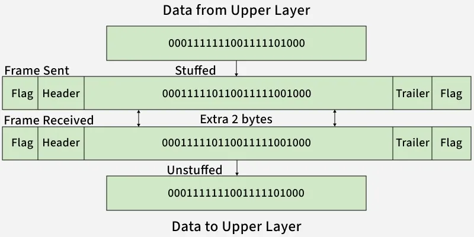
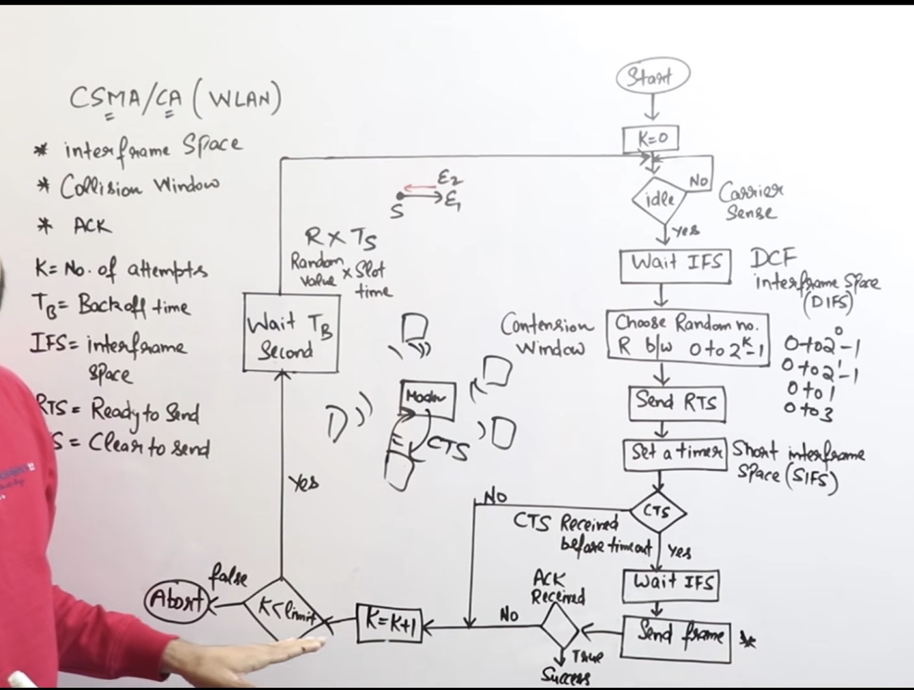

# Data Link
- 2 sub layers 
    1. LLC (Logic Link Control)
    2. MAC (Multiple or Medium Acesses Control )

### Functions :

1. Hop to Hop Delivery 
- i.e to which router or node on network layer and other layers packet goes.

2. Flow Control :
- control speed
    1. Stop n Wait
    2. Go Back n
    3. Selective Repeat

3. Error Control from hop to hop
- CRC , Checksum , Parity.

4. Acesses Control :
who send when.
- CSMA/CD , ALOHA , Tosem

### Stop n Wait
> Send Frame 0 , wait , Receive Ack 1 , Send Frame 1 , Receive Ack 0 ... so on.

1. Sender window size = 1.
2. Reciever window size = 1.

- If Ack or Frame is lost i between , it waits TimeOut Restart time and sends again the same frame.

> Efficency = 1/(1+2x)
- x = Tp/Tt
- or Efficency = Total time / (Total time +  2*Propagation Delay)
ie Tt/(Tt+Tp)

## Go-Back-N ARQ (Automatic Repeat Request) 
1. Sequence number bits  :  m 
or m is no of bits to represent window size
2. Maximum sender window : 2^m - 1 
3. Receiver window : 1 
4. Type : Sliding-window protocol 
5. ACK type : `Cumulative ACK`
6. Out-of-order frames : Discarded 
i.e On frame loss => Retransmit from the missing frame onward.

> Efficency = (2^m-1) * 1/(1+2x)

## Selective Repeat ARQ 
1.  Sender window : 2^(m-1)
    Reciever window : 2^(m-1)
2. Out-of-order frames : Accepted 
- Retransmit = O(1) 
3. ACK type : Cumulative Ack , Independent Ack and `Neg ACK`
- Neg ACK is used to save TimeOut Restart time.

> Efficency = (2^(m-1)) * 1/(1+2x)

- For sliding-window utilization, a common formula (assuming negligible ACK transmission time and no errors) is:
> Ws >= 1 + (2*Tp)/Tt
> No. of sequence bits = ceil(log2 Ws) 

## Framing in Data Link Layer :

1.  Character/Byte Stuffing
- Used when data is character-based.

2. (b) Bit Stuffing

- Example Problem: Data = 011100011110, ED = 0111, After bit stuffing -> 011010001101100.
> ED = 0111 => whenever 2 1's appear in data , stuff a 0.

## Error Detection and Correction :
- Based on redundunt bits ie send more or extra bits.

### Error Detection
1. Single Bit Parity
- Even Parity : no of 1's should be even.
- detects all single bit errors
- can detect all `odd` no of errors also.
> detects d-1 errors 
d = Minimum Hamming Distance 
- The minimum Hamming distance is the smallest number of bit positions in which any two distinct valid codewords differ.

2. CRC 
- Add m bits to the end then do division till <m bits remain

## Hamming Code 
- Error Detection and Correction both
> 2^r >= m+r+1

1. 2^ i , i = 0,1,2,3.....
are parity bits and rest for data.

2. Parity bits 
- Pi =>>> XOR dj bits (i times) and leave i then again dj bits (i times).
- example :
P1 = 1,3,5,7,...
P2 = 2,3  ,6,7   ,10,11
P4 = 4,5,6,7    ,12,13...
....

> Error bit = BINARY(P4.P3.P2.P1)

## Multiple or Medium Acesses Control 

1. Random Acesses Protocol : 
    1. ALOHA
        1. PURE ALOHA
        2. SLOTTED ALOHA
    2. CSMA
    3. CSMA/CD , CSMA/CA

2. Control Acesses
    1. Polling
    2. Token Passing

3. Channelization Protocols
    1. FDMA
    2. TDMA

### PURE ALOHA
- Pure ALOHA is a random-access MAC protocol in which a station transmits whenever it has data, without checking whether the channel is busy.
1. ACK is there
    => Retransmissions.
2. LAN Based (Obselete now)
3. Vulnerable time is `2*Tt`
4. Efficency = `G*e^-2G`
- G = No of Stations tryin to transmit data at some time
- For max Efficency , differentiate wrt G.
- G = 1/2 
> 18.4% (1/2e)

### SLOTTED ALOHA
- Slots of size Tt.
4. Efficency = `G*e^-G`
- G = 1
> 36.8% (1/e)

### CSMA (Carrier Sense Multiple Access)
1. 1 Persistant :
- Node continously Senses the channel , If free transmits else Senses.

2. 0 Persistant
- Node Senses the channel , If free transmits else waits a random time then senses again.

3. p Persistant
- Node Senses the channel , If free transmits else waits a P time then senses again.

### CSMA/CD
- No ACK used.
- To detect collision (node should be transmitting continously else it cant if it stopped) then total transmission time
> TT >= 2*PD
- or L(length of message) >= 2*PD*BW
- PD = Cable length / Signal Speed

> Efficency = 1/(1+6.44a)
a = PD/TT
 
### CSMA/CA
- In Wireless
- CSMA/CA (Carrier Sense Multiple Access with Collision Avoidance): Tries to avoid collisions `before transmitting`. 
- Working
1. Sense the channel.
2. If idle, wait for DIFS.
3. Transmit; otherwise, wait and use a random backoff.
4. Receiver sends ACK after SIFS.
5. Optional RTS/CTS helps reduce hidden-terminal collisions.

## Ethernet Frame Format (IEEE-802.3)
- Ethernet (IEEE 802.3): A wired LAN technology that defines the physical and data-link layer standards.
- uses bus topology.

1. Preamble : 7 B => 56bits
- added by physical layer
- Constant bits
10101010....

2. SFD 1 B
- added by physical layer
- Constant bits
10101011

3. Dest. MAC : 6 B

4. Source MAC : 6 B

5. Type/Length : 2 B

6. Data + Pad : 46–1500 B

7. CRC : 4 B

> Min Ethernet Frame Size = 64 + 8 
  Maxm Ethernet Frame Size = 1518

## Token Ring (IEEE 802.5)
1. Topology : Logical ring 
2. Access method : Token passing 
3. Collisions : No collisions during normal operation 
4. Transmission : Station holding the token transmits.
5. Access : Deterministic and bounded 
6. Priority : Supports priority mechanism.

- How it works
1. A free token circulates around the ring.
2. A station captures the token and transmits its frame.
3. The frame travels around the ring to the destination.
4. The frame is removed, and the token is released for another station.

- token circulates unidirectionally.

| Field | Function |
|---|---|
| SD | Marks the start of the frame |
| AC | Contains priority, reservation, and token-related control bits |
| FC | Identifies whether the frame carries data or control information |
| DA | Destination address |
| SA | Source address |
| FCS | CRC-based error detection |
| ED | Marks the end of the frame |
| FS | Indicates frame status, such as address recognized and frame copied |

> Effective data rate = Efficiency * Bandwidth

- Efficiency =  (N * Td) / 
                N(Td+Rl) + Rl

    