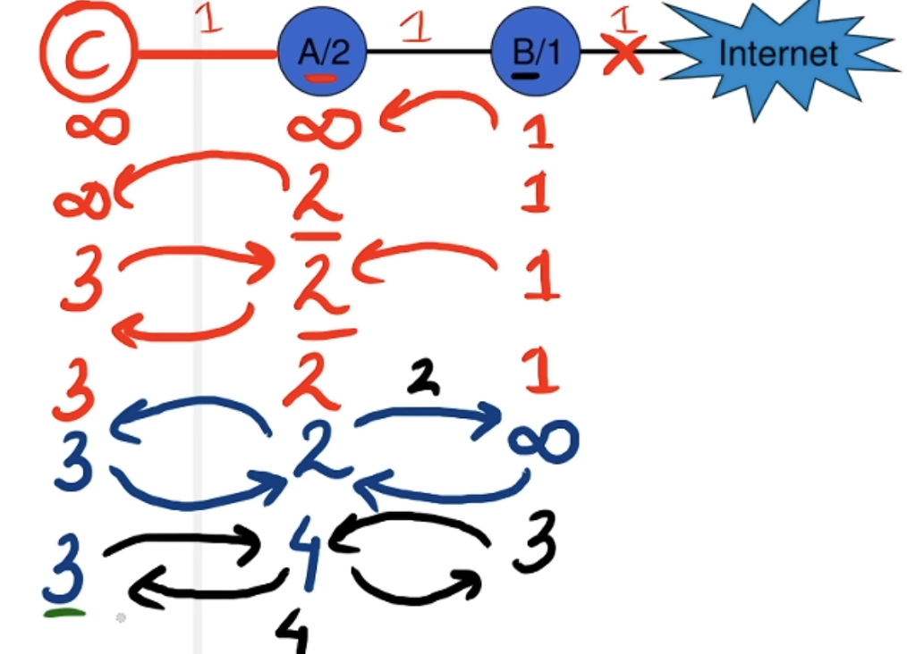

# Routing protocols 
- help routers discover paths and select routes for forwarding packets between networks.


## Distance vector Routing
- `IntraDomain` Protocol.
- Each router maintains a routing table containing the distance (cost) and next hop to reach each destination. 
- Routers exchange distance vectors with their immediate neighbours.

> Each node upadtes its routing table independemtly and parellely.
- Final Table is after multiple passes n shortest one.

### Count to Infinity
- Count to infinity is a problem in Distance Vector Routing where routers keep increasing the advertised distance to an unreachable destination because of incorrect information exchanged between them.
- EXAMPLE : If link breaks between B & Internet.



## Link state routing
- Link State Routing is a routing technique in which each router learns the network topology and calculates the shortest path to every destination using `Dijkstra’s algorithm`.
- Working :
    - Every node makes its Link state routing Table.
    - Flooding of Link state routing Tables.
    - Build topology database — every router builds a map of the network.
    - Run Dijkstra’s algorithm — calculate shortest paths and construct the routing table.

| Feature | Link State | Distance Vector |
|---|---|---|
| Algorithm | Dijkstra | Bellman–Ford |
| Information shared | Link-state information | Distance vector with next-hop costs |
| Shared with | Flooded throughout the network | Immediate neighbors |
| Network knowledge | Complete topology map | Neighbor-provided distance information |
| Convergence | Generally faster | Generally slower |
| Complexity | Higher memory and computation | Simpler computation |
| Count-to-infinity | Not a characteristic problem | Can occur |
| Examples | OSPF, IS-IS | RIP |


# Network Address Translation
- NAT translates private IP addresses into public IP addresses and vice versa, allowing devices in a private network to communicate with external networks such as the Internet.
- How NAT works
```yml
            Private Network
                PC1: 192.168.1.2
                PC2: 192.168.1.3
                .
                .
                .


            NAT Router
                Translates private IP ↔ public IP


            Internet
                Public IP: 203.0.113.5
```

1. Static NAT: one private IP ↔ one public IP.
2. Dynamic NAT: public IP allocated from a pool.
3. PAT: many private IPs share one public IP through port translation.

> NAT Router uses Public IP of its and also the port no of the Host device isnt used.

