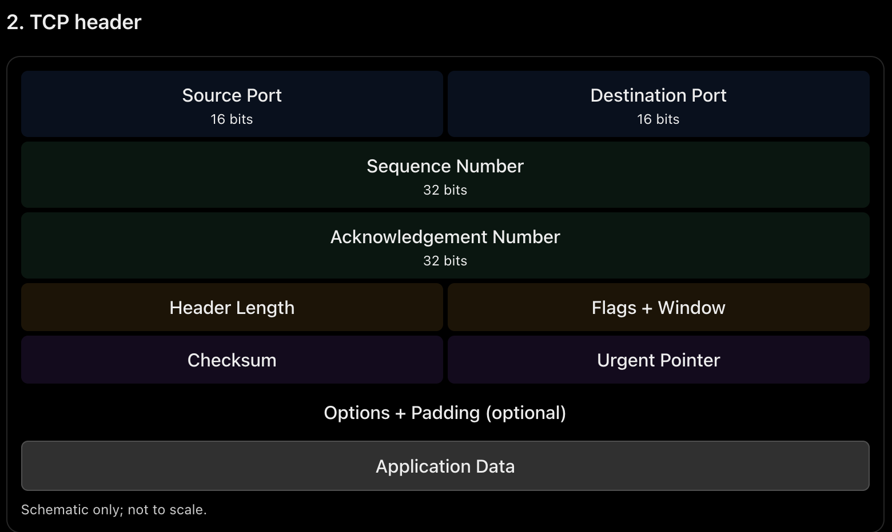
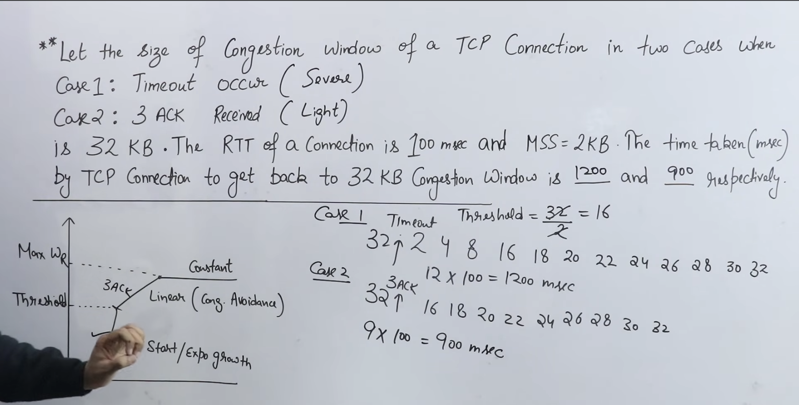
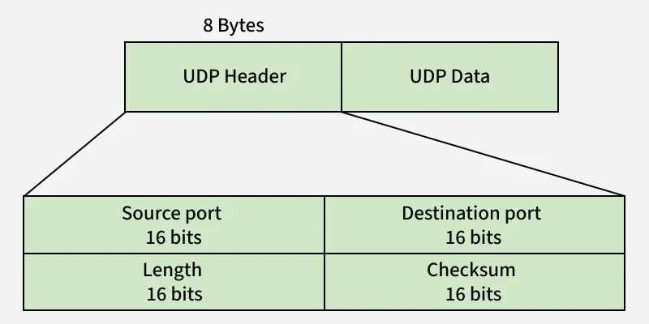

# TCP: Transmission control protocol
- TCP is a connection-oriented, `reliable`, full-duplex transport-layer protocol that provides ordered delivery of data between applications.
- Key features
1. Connection-oriented: Establishes a connection before data transfer. 3 Way Handshake.
2. Reliable: Uses acknowledgements, sequence numbers and retransmissions.
3. Ordered delivery: Delivers data in the correct byte order.
4. Full-duplex: Both sides can send and receive simultaneously.
5. Flow control: Prevents overwhelming the receiver using a receive window.
6. Congestion control: Adjusts transmission to reduce network congestion.
7. Byte-stream: TCP treats data as a continuous stream of bytes, not separate messages. `segment`   



1. Flags 
    1. URG (Urgent) flag 
    - in the TCP header indicates that the data in the TCP segment contains urgent information that should be processed with priority.
    - How URG works
        1. Sender sets the URG = 1 flag.
        2. The Urgent Pointer field becomes valid.
        3. The Urgent Pointer identifies the `end of the urgent data` (in the traditional TCP interpretation).
        - If Urgent Pointer = 40 ==> 0 to 40th byte are URG ===> 41 bytes.
        4. The receiver can process the urgent data ahead of normal data.


## Congestion control




## UDP 
is a connectionless, transport-layer protocol that sends independent datagrams without guaranteeing delivery, ordering, or duplicate protection.
- 1. Key features
1. Connectionless: No connection establishment or three-way handshake.
2. Unreliable: No built-in guarantee of delivery.
3. No sequencing guarantee: Datagrams may arrive out of order.
4. Low overhead: Small header of only 8 bytes.
5. Message-oriented: Preserves datagram boundaries.
6. No built-in flow or congestion control like TCP.
7. Supports unicast, multicast and broadcast where the underlying network supports them.
8. Checksum for error detection.


> Source port is ephemeral, destination port is well-known → usually client to server.
> Source port is well-known, destination port is ephemeral → usually server to client.

## DNS :
- DNS is an application-layer protocol that translates domain names (e.g., google.com) into IP addresses so that clients can locate servers on a network.

1. DNS hierarchy
```yml
    Root DNS (.)
    
    TLD DNS
        .com, .org, .in , .edu etc

    Authoritative DNS
         Contains records for a domain, e.g. example.com
```
- DNS is a distributed, hierarchical database. The hierarchy helps resolvers locate the authoritative information for a domain.

2. How DNS resolution works
- When you enter www.example.com in a browser:
    1. The client checks its local/browser `cache`.
    2. It queries a `recursive resolver` if no cached answer exists.
    3. The resolver may query a root server to find the relevant TLD(top-level domain) server.
    4. The TLD server points it toward the domain's authoritative DNS server.
    5. The authoritative server provides the requested record.
    6. The resolver returns the answer to the client and may cache it.

3. DNS ports and transport protocols
- Port	53
- Normal queries : Usually `UDP`
- Important: DNS can use both UDP and TCP on port 53. Do not memorize “DNS always uses UDP.”

4. Recursive vs iterative query
- Recursive query: The server receiving the query is asked to return the final answer or an error.
- Iterative query: The server returns the best information it has, often a referral to another DNS server.
    - Root server has less load

## HTTP
- HTTP (Hypertext Transfer Protocol)
- HTTP is an application-layer protocol used for communication between web clients (browsers) and web servers. 
- It follows a `request–response` model.

1. HTTP working
    1. Client sends an HTTP request.
    2. Server processes the request.
    3. Server returns a response containing a status code and possibly data.
    4. The browser processes the response.

2. Features : 
- Port no 80
- Not Reliable itself but uses TCP to achieve it.
- Inband Protocol ie same port for send an recieve
- Stateless : No session or info of request is saved ie all requests are independent. Cookies etc can make it Statelfull.
- HTTP/1.0: Non - Persistent connections by default; 
- HTTP/1.1: Persistent connections by default; text-based message format.

3. HTTP methods
| Method | Purpose |
|---|---|
| GET | Retrieve a resource |
| POST | Submit data; often creates a resource |
| PUT | Create or replace a resource at a specified URI |
| PATCH | Partially modify a resource |
| DELETE | Delete a resource |
| HEAD | Same as GET, but returns no response body |
| OPTIONS | Ask about supported communication options/methods |

4. HTTP status codes
| Code range | Meaning | Examples |
|---|---|---|
| 1xx | Informational | 100 Continue |
| 2xx | Success | 200 OK, 201 Created, 204 No Content |
| 3xx | Redirection | 301 Moved Permanently, 302 Found, 304 Not Modified |
| 4xx | Client error | 400 Bad Request, 401 Unauthorized, 403 Forbidden, 404 Not Found |
| 5xx | Server error | 500 Internal Server Error, 503 Service Unavailable |

## Socket Programming
- A socket API is a set of programming interfaces that allows applications to communicate over a network using transport protocols such as TCP and UDP.
- A socket is one endpoint of communication between processes.

2. Important socket API calls
| Function | Purpose |
|---|---|
| socket() | Creates a socket |
| bind() | Assigns a local IP address and port |
| listen() | Marks a TCP socket as ready to accept connections |
| accept() | Accepts an incoming TCP connection |
| connect() | Initiates a connection to a remote endpoint |
| send() / write() | Sends data |
| recv() / read() | Receives data |
| close() | Closes a socket |

3. TCP socket call sequence
> sBLAsrc
```yml
TCP Server                  TCP Client   

socket()                    socket()  

bind()
listen()                      connect()
accept()                     

recv() / send()               send() / recv()

close()                       close()
```


