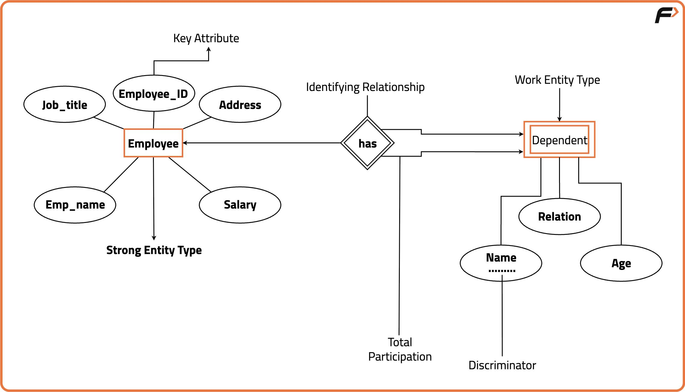
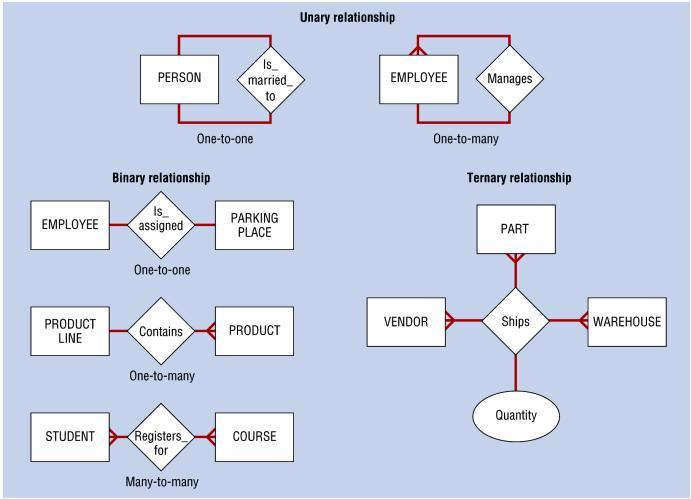
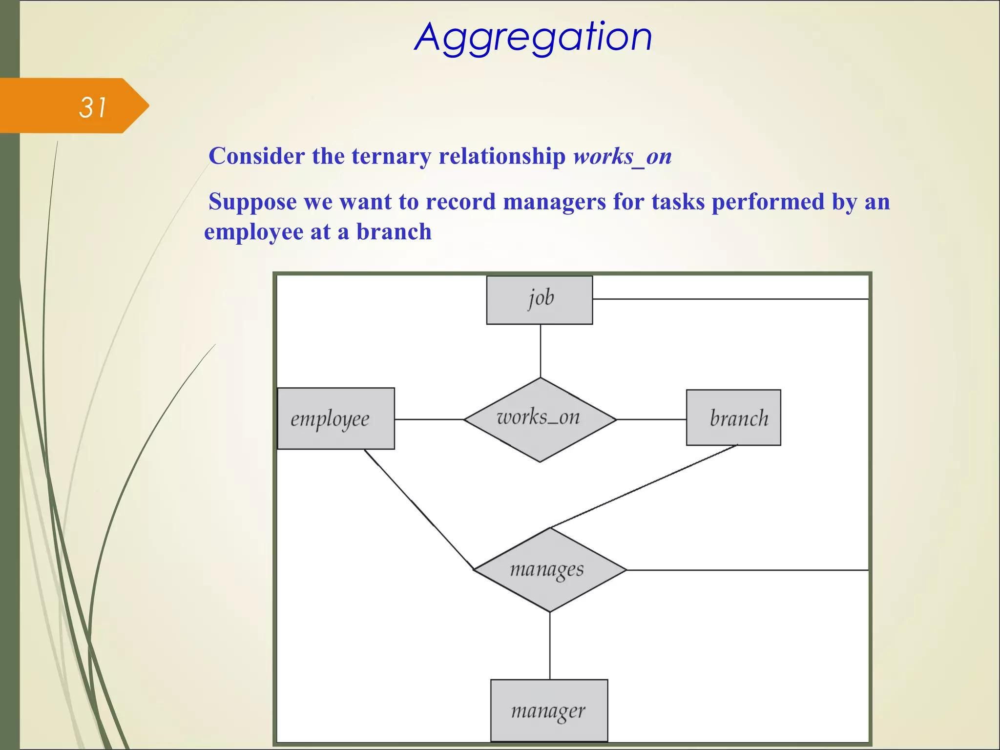

# 

## instance and schema 
- In a DBMS (Database Management System), an instance is the actual data stored in the database at a particular moment in time. It is also called the database state or snapshot.
> Instance: The current collection of data in the database at a specific time.
It changes whenever data is inserted, updated, or deleted.
> Understamd this as we use DML to manuplilate instance or rows of dbms and DDL for `schema`.
- A schema is the blueprint, while an instance is the actual contents of that blueprint.

## A procedural language 
- is a programming language where you write instructions step-by-step (procedures) to tell the computer how to perform a task.
- Examples
C
C++
Pascal
FORTRAN
COBOL

### Procedural SQL 
- means you specify how the database should perform an operation, using things like:
Loops
Conditions (IF/ELSE)
Variables
Procedures/functions
- For example, PL/SQL (Oracle) is a procedural extension of SQL.

> SQL is generally considered non-procedural/declarative, because you specify what data you want, not exactly how the DBMS should retrieve it.

## Integrity Constraints in Database
- Integrity constraints are rules imposed on a database to ensure that data remains accurate, valid, and consistent.

- Types of Integrity Constraints
1. Domain Constraint
Ensures that an attribute contains values from a valid domain (data type, range, or allowed values).
- Age INT CHECK (Age >= 18)

2. Key Constraint
Ensures that candidate key values uniquely identify tuples (rows).
- No two rows can have the same candidate key value.
- A candidate key must uniquely identify each tuple.
- A candidate key is minimal: removing any attribute means it no longer uniquely identifies tuples.

3. Entity Integrity Constraint
A primary key cannot contain NULL values.

4. Referential Integrity Constraint
A foreign key must match an existing referenced key value, or be NULL if NULLs are permitted.

## ER model
- The Entity–Relationship (ER) Model is a `high-level` conceptual database model used to represent real-world objects, their properties, and the relationships between them.
- Basic components of an ER model
1. Entity — Rectangle
2. Attribute — Oval
3. Relationship — Diamond.
4. Constraints – Rules governing entities and relationships.

## 1. Entity — Rectangle
- An entity is a real-world object that can be uniquely identified.
    - Examples: Student , Employee , Department , Course , Book
- An entity set is a collection of similar entities. :

### Types of Entities
1. Strong Entity
- Has its own primary key.
- Exists independently.
- Represented by a single rectangle.
Example: Student(Roll_No, Name, Age).

2. Weak Entity
- Does not have a complete primary key of its own.
- Depends on a strong entity for identification.
- Represented by a `double`rectangle.
- Has a `partial key` called a discriminator.
- Connected to its owner through an identifying relationship.

- Characteristics of a Weak Entity
1. It does not have a primary key of its own.
2. It depends on a strong entity for its existence.
3. It has a Partial Key (Discriminator).
4. It participates totally in its identifying relationship.
5. It is represented by a double rectangle in an ER diagram.

## 2. Attributes - Oval
An attribute describes a property of an entity `or relationship`.
- STUDENT(Roll_No, Name, Age, Address)
    - Here, Roll_No, Name, Age and Address are attributes.

### Types of attributes
1. Simple : Cannot be divided further e.g Age
2. Composite : Can be divided into subattributes e.g Name → FirstName, LastName 
3. Single-valued : One value per entity e.g DateOfBirth 
4. Multivalued : Multiple values per entity e.g PhoneNumbers `double oval.`
5. Derived : Calculated from another attribute e.g Age from DateOfBirth `dashed oval.`
6. Key attribute : Uniquely identifies an entity e.g StudentID `underlined name.`

- Identifying relationship → double diamond.
- Total participation → double line.

## 1.4 Relationship
- A relationship represents an association between entities.
- Example:
    - STUDENT — ENROLLS — COURSE
    - Here, ENROLLS is the relationship.

1. Plain line (—)
> Represents many participation on that side.
2. Line with arrow (→)
> Represents one participation on that side.

### Degree of Relationship
- Degree refers to the number of participating entity sets.

1. Unary	: 
- One entity set	
- Employee supervises Employee

2. Binary	
- Two entity sets	
- Student enrolls in Course

3. Ternary	
- Three entity sets	
- Supplier supplies Part to Project

4. N-ary	
- N entity sets	
- General relationship

- Important: Degree and cardinality are different concepts.
> Degree = Number of participating entity sets.
> Cardinality = Maximum number of entities that can participate in a relationship.

> 1. Cardinality means the number of tuples (rows) in a relation.
> 2. Degree means the number of attributes (columns) in a relation

## 1.6 Participation Constraints
Participation specifies whether every entity must participate in a relationship.

1. Total Participation
Every entity must participate in at least one relationship.
- Represented by a double line.
- Also called mandatory participation.
> Every employee must belong to a department.

2. Partial Participation
Some entities may not participate in the relationship.
- Represented by a single line.
- Participation is optional.
- Example:
    - Some employees may not manage any department.

- Cardinality vs Participation
- Cardinality	
Specifies maximum participation	
1:1, 1:N, M:N	
Maximum number	

- Participation
Specifies minimum participation
Total or Partial
Minimum number

## 1.7 Relationship Attributes
Attributes can also belong to relationships.
- Example:
STUDENT — ENROLLS — COURSE
- ENROLLS may have:
    - Enrollment_Date
    - Grade
    - Semester
- These attributes describe the relationship, not just Student or Course.

##  Recursive Relationship
A relationship between entities of the same entity set.
- Example:
    - Employee supervises Employee.
- 1-1 unary realtionship
Here, the same entity set participates twice with different roles.

Roles:
- Supervisor
- Subordinate

## Generalization
- Bottom-up approach.
- Combines multiple lower-level entity sets into a higher-level entity set.
    - Car + Bike → Vehicle.

## Specialization
- Top-down approach.
- Divides a higher-level entity set into lower-level entity sets.
    - Employee → Manager, Engineer, Clerk. 

## 1.10 Aggregation
Aggregation treats a relationship set as a higher-level entity so that it can participate in another relationship.

Example:
- Employee works on Project.
- Manager monitors the Employee-Project assignment.

- Here, the relationship Works_On is treated as a higher-level object.

## RDBMS (Relational Database Management System) 
- is a type of DBMS that stores data in the form of tables (relations) consisting of rows and columns.

## ER Model to Relational Model Conversion Rules (GATE)
1. Strong Entity
- Create a separate table.
- All simple attributes become columns.
- Entity's key attribute becomes the Primary Key.
- Composite attributes are divided into simple attributes.
- Derived attributes are generally not stored.

2. Weak Entity
- Create a separate table.
- Include its own attributes.
- Include the owner's Primary Key as a Foreign Key.
- Primary Key = Owner's PK + Weak Entity's Partial Key.

3. 1 : 1 Relationship
- Add the Primary Key of one entity as a Foreign Key in the other table.
- Prefer the entity having total participation.
- Add relationship attributes to the same table.

4. 1 : N Relationship
- Add the Primary Key of the 1-side as a Foreign Key in the N-side table.
- Add relationship attributes to the N-side table.

5. M : N Relationship
- Create a separate table.
- Include Primary Keys of both participating entities as Foreign Keys.
- Combined Foreign Keys generally form the Primary Key.
- Add relationship attributes.

6. N-ary Relationship
- Create a separate table.
- Include Primary Keys of all participating entities as Foreign Keys.
- Combined keys generally form the Primary Key.
- Add relationship attributes.

7. Multivalued Attribute
- Create a separate table.
- Include the entity's Primary Key as Foreign Key.
- Include the multivalued attribute.
- Combined attributes form the Primary Key.

8. Composite Attribute
- Store only simple components.
- Example: Name → First_Name, Middle_Name, Last_Name.

9. Derived Attribute
- Generally, do not create a column.
- Calculate when required.
- Example: Age derived from DOB.

10. Recursive Relationship
- 1 : 1: Self-referencing Foreign Key.
- 1 : N: Self-referencing Foreign Key on the N-side (same table).
- M : N: Create a separate relationship table with two FKs referencing the same table.

