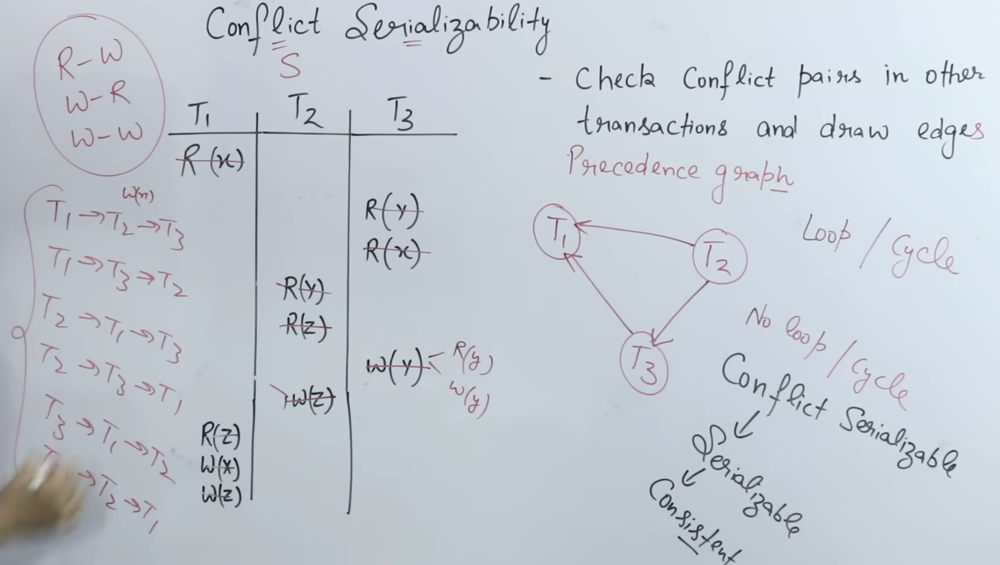

# Serializability
Serializability is a correctness criterion used to determine whether a non-serial schedule is equivalent to some serial schedule.

## Types of Serializability
1. Conflict Serializability
Based on conflicting operations

2. View Serializability
Based on read-from and final-write relationships

## Conflict Equivalent Schedules

## 1. Conflict Serializability | Precedence Graph
- A schedule is conflict serializable if it can be transformed into a serial schedule by swapping non-conflicting operations.

### Precedence Graph?
A Precedence Graph is a directed graph used to determine whether a schedule is conflict serializable.

It consists of:
- Vertices (Nodes): Transactions.
- Directed Edges: Conflict-based dependencies between transactions.

### Rules to construct a Precedence Graph
1. Step 1: Create one node for each transaction.
2. Step 2: Identify conflicting operations.
3. Step 3: Draw a directed edge from the transaction performing the earlier operation to the transaction performing the later operation.
T_i -> T_j
> This means transaction \(T_i\) must execute before transaction \(T_j\) in an equivalent serial schedule
4. Step 4: Check whether the graph contains a cycle.
- No cycle → Conflict Serializable.
- Cycle present → Not Conflict Serializable.


### Sequebce of Non confliction :
1. Start with Indegree = 0.
> Indegree of a vertex = Number of edges coming INTO that vertex.
2. Remove edges.
3. Keep adding Indegree = 0 node.

## 2. View Serializability
- View serializability is a concept used to determine whether a given schedule is equivalent to some serial schedule based on the values read and the final values written.
A schedule is view serializable if it is view equivalent to at least one serial schedule.

### 1. View Equivalence
Two schedules \(S_1\) and \(S_2\) are view equivalent if all three conditions hold:
1. Condition 1: Initial Read
If a transaction reads the initial value of a data item in one schedule, it must also read the initial value in the other schedule.

2. Condition 2: Read-From Relationship
If transaction \(T_i\) reads a value of data item \(X\) written by transaction \(T_j\) in one schedule, then it must read the value written by the same transaction \(T_j\) in the other schedule.

3. Condition 3: Final Write
The transaction that performs the final write on a data item must be the same in both schedules.
- Remember: These conditions compare the source of read values and the final writer, not necessarily the order of all operations.

---
Initial Read: Same initial read values.
Updated Read: Same updated read values.
Final Update/Write: Same final write values.
---

> A blind write occurs when a transaction writes a data item without reading it first.

## Shared Exclusive Locking Protocol 
- Lock-based protocols are used in DBMS to control concurrent access to data items and maintain database consistency.
- A Lock is a mechanism that controls access to a data item by multiple transactions.

There are two basic types of locks:
1. Shared Lock (S-lock)
2. Exclusive Lock (X-lock)

1. Shared Lock (S-Lock)
A Shared Lock is also called a Read Lock.
- A transaction can read a data item.
- Multiple transactions can hold a shared lock on the same data item simultaneously.
- A transaction cannot write the data item while holding only a shared lock.

2. Exclusive Lock (X-Lock)
An Exclusive Lock is also called a Write Lock.
- A transaction can read and write a data item.
- Only one transaction can hold an exclusive lock on a data item at a time.
- No other transaction can hold either an S-lock or X-lock on that item.

### 3. Lock Compatibility Matrix
- The compatibility matrix tells us whether two transactions can hold locks on the same data item simultaneously.

Existing Lock ↓ / Requested Lock →	        Shared (S)	        Exclusive (X)
Shared (S)	                                Compatible	        Not Compatible
Exclusive (X)		                        Not Compatible  	Not Compatible

## 6. Two-Phase Locking Protocol (2PL)
The basic Shared-Exclusive locking protocol does not by itself guarantee conflict serializability.
- To guarantee conflict serializability, DBMS uses the Two-Phase Locking Protocol (2PL).
It has two phases:
1. Phase 1 : Growing Phase
    - Transaction can acquire locks.
    - Transaction can upgrade locks.
    - Transaction cannot release any lock.

2. Phase 2 : Shrinking Phase
    - Transaction can release locks.
    - Transaction can downgrade locks.
    - Transaction cannot acquire new locks or upgrade locks.

- The point at which a transaction acquires its last lock is called the `Lock Point`.
- After the lock point, the transaction enters the shrinking phase.

### Props:
1. Guarantees Conflict Serializability

2. Deadlocks and Stravation are Possible

3. Cascading Rollback is Possible
- Basic 2PL does not prevent cascading rollback.
A transaction may release its locks before committing, allowing another transaction to read its uncommitted data.

4. Transactions May Not Be Recoverable

## 6. Types of 2PL
There are four important variants of Two-Phase Locking.

1. A. Basic 2PL
- Follows growing and shrinking phases.
- Locks can be released before commit.
- Guarantees conflict serializability.
- Deadlocks are possible.
- Cascading rollback is possible.

2. B. Strict 2PL
- Holds all exclusive (X) locks until commit or abort. 
>    => Produces Cascadeless Rollbacks and Recoverable Schedule.
- Shared locks may be released earlier.
- Prevents dirty reads and dirty writes.
- Produces strict schedules.
> - Deadlocks and Stravation are possible.

3. C. Rigorous 2PL
- Holds both shared (S) and exclusive (X) locks until commit or abort.
>    => Produces Cascadeless Rollbacks and Recoverable Schedule.
- Releases all locks only after transaction completion.
- Produces strict schedules.
> - Deadlocks and Stravation are possible.

4. D. Conservative 2PL (Static 2PL)
- A transaction acquires all required locks before it starts execution.
- If all locks are not available, it waits without acquiring any.
> - Prevents deadlocks.
- Guarantees conflict serializability.

```yml
Q: A conflict serializable schedule is always allowed by 2PL. TRUE
Q: A conflict serializable schedule is always allowed by 2PL. FALSE
```
