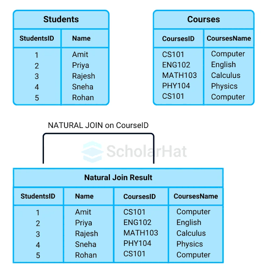
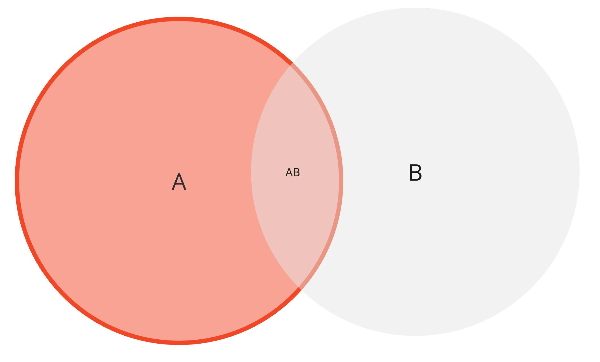

# JOIN 
is an operation in SQL and Relational Algebra used to combine rows from two or more tables based on a related attribute or condition.

## Types
The important types of joins are:
1. Inner Join
2. Left Outer Join
3. Right Outer Join
4. Full Outer Join
5. Cross Join
6. Natural Join
7. Self Join
8. Equi Join
9. Theta Join

1. Natural Join
- A NATURAL JOIN automatically joins two relations using all common attribute names.
It:
- Finds common attributes.
- Matches rows having equal values in those attributes.
- Displays the common attribute only once.
```sql
SELECT *
FROM Student
NATURAL JOIN Department;
```
- Important: Natural Join is an Equi Join on all common attributes, followed by removal of duplicate common columns.


> Degree(R <> S) = Degree(R) + Degree(S)-Common Attributes

- Cardinality of Natural Join
If R has m tuples and S has n tuples:
> 0 <= |R <> S| <= m*n
- The exact cardinality depends on the matching values.

2. Self Join 
- A SELF JOIN joins a table with itself.
- It is useful when records in the same table are related.
- Example: Employee and Manager are stored in the same table.
```sql
SELECT E.Name AS Employee,
       M.Name AS Manager
FROM Employee E
JOIN Employee M
ON E.Manager_ID = M.Emp_ID;
```

3. Equi Join
- An EQUI JOIN is a join in which the joining condition uses only the equality operator (=).
```sql
SELECT *
FROM Student S
JOIN Department D
ON S.Dept_ID = D.Dept_ID;
```
- Unlike Natural Join, Equi Join generally retains both copies of the common join column if SELECT * is used.

4. Left Outer Join
A LEFT JOIN returns:
- All rows from the left table.
- Matching rows from the right table.
- NULL values where no match exists.
```sql
SELECT *
FROM Student S
LEFT JOIN Department D
ON S.Dept_ID = D.Dept_ID;
```
- Remember: All rows of the LEFT table are preserved.


 