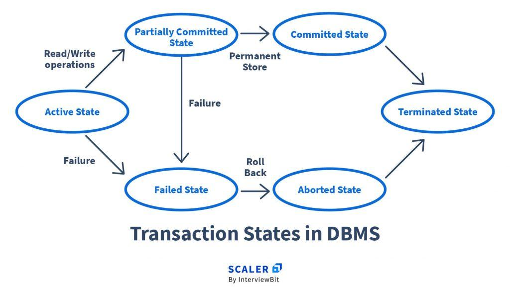

# Transaction Concurrency

## Transaction?
A transaction is a sequence of database operations performed as a single logical unit of work.
A transaction must either:
- Execute completely (commit).
- Have no effect on the database (rollback).

## Transaction Concurrency?
- Transaction concurrency means executing multiple transactions simultaneously or in an interleaved manner in a database.
- Instead of executing one transaction completely before starting another, the DBMS allows multiple transactions to execute concurrently.
- The DBMS must ensure that concurrent execution does not produce incorrect results.

## Why is Concurrency Control Required?
Concurrency control ensures that multiple transactions execute safely without violating database consistency.

Main objectives:
1. Improved throughput: More transactions can be processed per unit of time.
2. Reduced waiting time: Transactions do not need to wait for another transaction to finish unnecessarily.
3. Resource utilization: CPU and I/O resources are used efficiently.
4. Database consistency: Prevents incorrect results caused by concurrent execution.

## 4. Problems Due to Concurrent Execution
This is a very important topic for GATE.
1. Lost Update Problem
Occurs when two transactions update the same data item, and one transaction overwrites the update performed by another.

2. Dirty Read Problem
Occurs when one transaction reads data written by another transaction that has not yet committed.

3. Unrepeatable Read Problem
Occurs when a transaction reads the same data item twice and gets different values because another transaction modifies it in between.

4. Incorrect Summary Problem
Occurs when one transaction calculates an aggregate value while another transaction is updating the same data items.

---
1. Lost Update: Updates overwrite each other.
2. Dirty Read: Reading uncommitted data.
3. Unrepeatable Read: Same transaction reads the same item twice but gets different values.
4. Incorrect Summary: Aggregate calculation gets inconsistent data due to concurrent updates.
---

## ACID Properties in DBMS
ACID properties are a set of four properties that ensure reliable and correct execution of database transactions.

ACID stands for:
- A – Atomicity
- C – Consistency
- I – Isolation
- D – Durability

1. Atomicity
Definition: A transaction must be executed completely or not executed at all.
- It means a transaction is an indivisible unit of work.
- Remember: Atomicity is maintained using rollback and recovery mechanisms.

2. Consistency
- Definition: A transaction must take the database from one consistent state to another consistent state.
- It ensures that all database constraints and integrity rules are maintained before and after a transaction.
Remember: Consistency ensures that database constraints are never violated by a successfully committed transaction.

3. Isolation
- Definition: Concurrent transactions should execute independently without interfering with each other.
- The execution of concurrent transactions should produce results equivalent to some correct serial execution.
- Remember: Isolation is achieved using concurrency control techniques such as:
    - Lock-based protocols
    - Timestamp-based protocols
    - MVCC

4. Durability
Definition: Once a transaction is successfully committed, its changes must remain permanent, even if a system failure occurs.

Remember: Durability is maintained using:
- Logs
- Stable storage
- Recovery mechanisms

## Transaction States
- A transaction passes through different states during its execution, from the beginning until completion or failure.

There are 5 major transaction states in DBMS:
1. Active
2. Partially Committed
3. Committed
4. Failed
5. Aborted

1. Active State
- This is the initial state of a transaction.
- The transaction is currently executing its read and write operations.
- It remains active until its final statement executes or an error occurs.
The transaction is in the Active state.

2. Partially Committed State
- The transaction has executed its final statement.
- However, the changes are not yet guaranteed to be permanently committed.
- The system must complete the commit process successfully.
After executing the final operation but before the commit is safely completed, the transaction is partially committed.

3. Committed State
- The transaction has completed successfully.
- All its changes are permanently recorded.
- The transaction cannot be rolled back as an ordinary uncommitted transaction.

4. Failed State
- A transaction enters the failed state when it cannot proceed further.
- This may happen due to:
  - System crash
  - Hardware failure
  - Logical error
  - Deadlock
  - Constraint violation
Example: A transaction tries to withdraw more money than allowed by a database constraint.

5. Aborted State
- A transaction enters the aborted state after all its effects have been undone.
- The database is restored to the state it had before the transaction started.
After abortion, two possibilities exist:
1. Restart the transaction as a new transaction.
2. Completely terminate the transaction.

### 3. Transaction State Transitions
1. Active → Partially Committed	
- Final statement executed
2. Active → Failed	
- Error occurs during execution
3. Partially Committed → Committed	
- Commit successfully completed
4. Partially Committed → Failed	
- Failure before successful commit
5. Failed → Aborted	
Rollback completed
6. Aborted → Active	
Transaction restarted

## Schedule
- A Schedule is the sequence or order in which the operations of multiple transactions are executed in a database.
- A schedule must preserve the order of operations within each individual transaction.
- The main operations considered are:
    - Read(X) – Reads data item X.
    - Write(X) – Modifies data item X.
    - Commit – Successfully completes a transaction.
    - Abort – Aborts a transaction.

### 2. Types of Schedules
1. Serial Schedule
2. Non-Serial Schedule

1. Serial Schedule
A Serial Schedule is a schedule in which one transaction completes entirely before another transaction starts.
- There is no interleaving of operations between transactions.
- Less concurrency and potentially lower throughput.

2. Non-Serial Schedule
A Non-Serial Schedule is a schedule in which operations of multiple transactions are interleaved.

## Conflicting Operations
Two operations are said to be conflicting if all three conditions are satisfied:
1. They belong to different transactions.
2. They operate on the same data item.
3. At least one of them is a WRITE operation.
If all three conditions are satisfied, the operations are conflicting.

2. Types of Operations
- There are three possible pairs of operations:
1. Read(A)	Read(A)	
- Conflict : No	

2. Read(A)	Write(A)	
- Yes

3. Write(A)	Read(A)	
- Yes	

4. Write(A)	Write(A)	
- Yes	

- Important: Operations on different data items never conflict, even if both are WRITE operations.

> Important Concept: Non-Conflicting Operations Can Be Swapped

## Irrecoverable Vs Recoverable Schedules

1. Recoverable Schedule
A schedule is called Recoverable if a transaction commits only after the transaction whose data it has read has committed.
If T2 reads a value written by T1, then T2 must commit after T1 commits.

2. Irrecoverable Schedule
A schedule is called Irrecoverable if a transaction commits before the transaction whose uncommitted data it has read.

## Cascading vs Cascadeless Schedule
1. Cascading Schedule
A schedule is called a cascading schedule if it allows transactions to read uncommitted data written by other transactions, potentially resulting in cascading rollback.
- Important: A cascading schedule does not necessarily experience a rollback every time. It allows the possibility of cascading rollback.
- Cascading Rollback?
    - Cascading rollback occurs when the failure of one transaction forces other dependent transactions to roll back as well.
    - This happens when transactions read uncommitted data written by other transactions.
    - in dirty read.

2. Cascadeless Schedule
A schedule is called Cascadeless if a transaction reads a data item only after the transaction that last wrote that item has committed.
- No transaction is allowed to read uncommitted data.

> Strict 
- Reader and writer both wait until previous writer commits/aborts

## CARSH OCCOURS :
Golden rule:
- Committed transaction → REDO its operations.
- Uncommitted transaction → UNDO its operations.

## General Formula
- If transaction T₁ has n₁ operations, T₂ has n₂ operations, and T₃ has n₃ operations, the total number of possible interleaved (concurrent) schedules is given by the multinomial coefficient formula:
> Total Schedules = (n1+n2+n3)! / n1!.n2!.n3!

