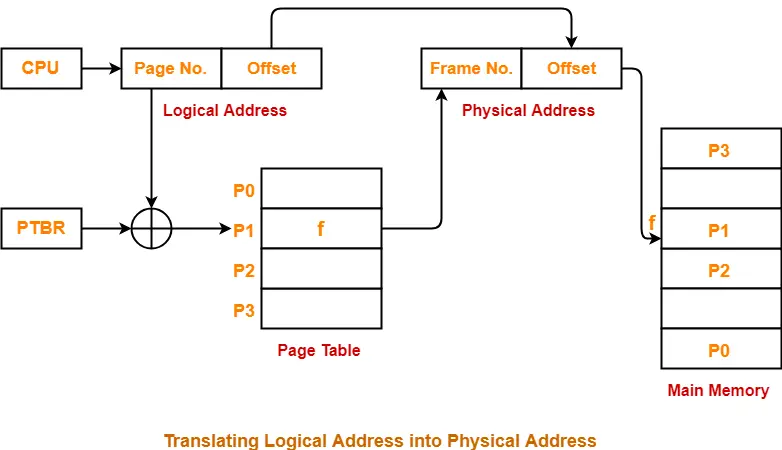

#
1. Page size determines offset bits.
2. Logical address size determines total bits.
3. Remaining bits determine page number.
    - 2^(page number) give no of pages.
4. Page table entry is Frame number.
    - Total page size = No of pages * Log2(Number of Frames)

##

- The CPU needs to access the memory location where a is stored.

1. The CPU generates a Logical Address (LA).
- This address is also called a Virtual Address (VA).
- The process works with logical addresses, not actual RAM addresses.
> Each process has its own virtual address space.

2. How is Logical Address translated into Physical Address?
The MMU (Memory Management Unit) is hardware responsible for translating logical addresses into physical addresses.

3. What is a Page?
- Virtual memory is divided into fixed-size blocks called Pages.
- Physical memory (RAM) is divided into fixed-size blocks called Frames.

- Page = block of virtual memory.
- Frame = block of physical memory.
> Page size = Frame size.

- A page can be stored in any available frame. They don't need to have the same number.

4. What does a Logical Address contain?
- A logical address is divided into two parts:
| Page Number (p)       | Offset (d) |
Identifies the page     Position inside page

5. What does a Page Table contain?
- Every process has its own page table (conceptually).
- The page table maps Virtual Page Numbers to Physical Frame Numbers.

6. What does a Page Table Entry (PTE) contain?
Each row in a page table is called a Page Table Entry.
- A PTE can contain:
    - Frame Number	Which physical frame contains the page
    - Valid/Present Bit	Whether page is currently in RAM
    - Protection Bits	Read, Write, Execute permissions
    - Dirty Bit	Whether page has been modified
    - Reference Bit	Whether page has been accessed
    - Other bits	Additional OS/hardware management information

7. What happens if the page is not in RAM?
- Suppose the page table says that Page 2 is not present in RAM.

CPU generates LA

MMU checks Page Table

Page Fault!

Page is not present in RAM

OS loads the required page from secondary storage into RAM

Updates Page Table and restarts the instruction