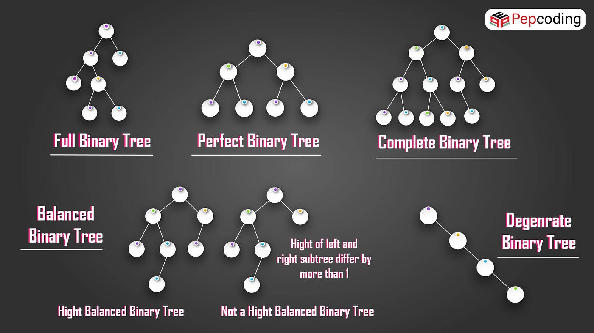
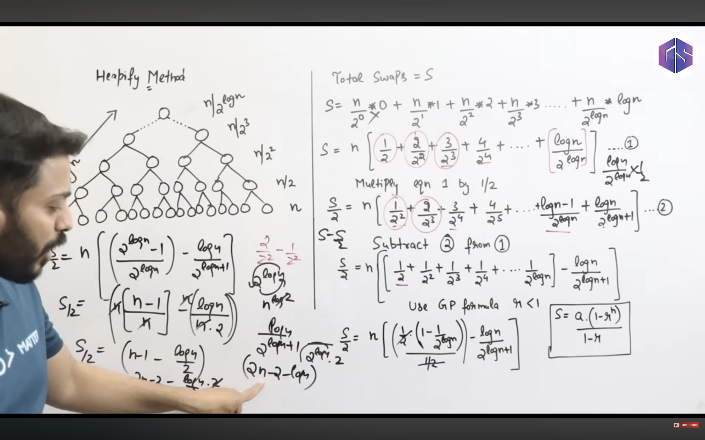

# GATE CS --- Trees and Heaps: Combined Notes

**Sources:** User-provided Gate Smashers transcripts: 1. *L-3.7:
Introduction to Trees (Binary Tree, Almost Complete Binary Tree, Full
BT, Complete BT, BST)* 2. *L-3.13: Introduction to Heap Tree with
examples \| Max Min Heap*

These notes combine the key concepts from both transcripts. Where the
first transcript uses "complete binary tree" differently from common
textbook terminology, that distinction is flagged.

------------------------------------------------------------------------

# Part A --- Introduction to Trees

## 1. Tree Basics

A **tree** is a hierarchical, non-linear data structure made of nodes
connected by edges.

-   A tree has no cycles.
-   In a rooted tree, the topmost node is the **root**.
-   **Parent:** node directly above another node.
-   **Child:** node directly below a parent.
-   **Leaf node:** node with zero children.
-   **Internal node:** non-leaf node with at least one child.
-   The root is one node; internal nodes can be multiple.
-   A tree is acyclic and connected (for an undirected tree).

## 2. Binary Tree
- A **binary tree** is a tree in which every node has **at most two
children**.
- A node can have: - 0 children - 1 child - 2 children
- The two child positions are called **left** and **right**.

    Number of children Valid in a binary tree?
  -------------------- -------------------------
                     0 Yes
                     1 Yes
                     2 Yes
             3 or more No
**Exam point:** A binary tree does not require every node to have two
children.

## 3. Full / Strict Binary Tree
- A full/strict binary tree has every node with either: - **0 children**
(leaf), or - **2 children** (internal node).
- No node may have exactly one child.
---
    Number of children Allowed in a full/strict binary tree?
  -------------------- ---------------------------------------
                     0 Yes
                     1 No
                     2 Yes

## 4. Almost Complete Binary Tree (ACBT)
1.  Fill each level from **left to right**.
2.  Move to the next level only after the previous level is full.
- In standard terminology, all levels above the last are full, and nodes on the last level occupy the leftmost positions.
- **Important:** Binary heaps use this structural property.

-------------------------------------------------------
  Term (common standard usage)        Definition
  ----------------------------------- -----------------------------------
  **Binary tree**                     Each node has at most 2 children.

  **Full / strict binary tree**       Every node has either 0 or 2
                                      children.

  **Complete binary tree**            Every level except possibly the
                                      last is full; last level is filled
                                      from left to right.

  **Perfect binary tree**             Every internal node has 2 children
                                      and all leaves are at the same
                                      depth.
  -----------------------------------------------------------------------


- Key relationships: 
    - Every perfect binary tree is full/strict. 
    - Every perfect binary tree is complete under the standard definition. 
    - A full/strict tree is not necessarily perfect. 
    - A complete tree need not be full/strict; a last-level node may have only a left child. 
    - Every full/strict tree is a binary tree.

------------------------------------------------------------------------

# Part B --- Heap Tree and Max/Min Heap

## 7. Heap Tree: Two Required Properties
- a tree is a heap only if it satisfies **both**:
1.  **Structural property:** It must be an Almost Complete Binary Tree
    (ACBT).
2.  **Ordering property:** It must satisfy the max-heap or min-heap
    relationship between every parent and its children.

## 8. Almost Complete Binary Tree (ACBT) Rules for a Heap
1.  Fill positions from **left to right**.
2.  Fill a level before moving to the next level.
3.  The final level may be partially filled, but there cannot be a gap
    to the left of an existing node.

A tree that violates ACBT is **not a heap**, even if its parent-child
values appear correctly ordered.

## 9. Max Heap
- A **max heap** satisfies:
    -   The root contains the maximum element.
    -   Every parent is **greater than or equal to** its children.
    -   The property must hold at every node/level.
- For every parent node `p` and child `c`: 
`p >= c`
``` yml
          10
        /    \
       8      7
      / \    / \
     5   4  6   3
```

## 10. Min Heap
A **min heap** satisfies:
-   The root contains the minimum element.
-   Every parent is **less than or equal to** its children.
-   The property must hold at every node/level.
- For every parent node `p` and child `c`: 
`p <= c`
``` yml
           1
         /   \
        3     2
       / \   /
      7   5 4
```
## 11. Max Heap vs Min Heap
  -----------------------------------------------------------------------------
  Property                Max heap                   Min heap
  ----------------------- -------------------------- --------------------------
  Root                    Maximum element            Minimum element

  Parent-child rule       Parent \>= child           Parent \<= child

  Priority queue use      Highest-priority/largest   Lowest-priority/smallest
                          key at root, depending on  key at root, depending on
                          convention                 convention

  Must be ACBT?           Yes                        Yes
  -----------------------------------------------------------------------------

**Important:** Heap ordering only constrains parent-child pairs.
Siblings do not need to be sorted relative to each other, and the whole
heap is not a sorted array.

## 12. How to Check Whether a Tree Is a Heap (GATE Method)
Always check in this order:
1.  **Check structure first:** Is it an ACBT?
    -   Levels filled in order.
    -   Last level filled from left to right.
    -   No missing left-side position before a node on the right.
2.  **If structure fails:** It is not a heap; stop checking.
3.  **Check ordering:**
    -   Max heap: every parent `>=` each child.
    -   Min heap: every parent `<=` each child.
4.  If both properties hold, it is a heap of that type.

------------------------------------------------------------------------

# Part C --- Quick Revision

## 13. Tree-Type Comparison

  --------------------------------------------------------------------------
  Type           Maximum children Child-count   Level/shape   Key ordering?
                                  restriction   restriction   
  ------------- ----------------- ------------- ------------- --------------
  Binary tree                   2 0, 1, or 2    None beyond   No
                                                being a       
                                                binary tree   

  Full/strict                   2 Every node    Not           No
  binary tree                     has 0 or 2    necessarily   
                                                all leaves at 
                                                same depth    

  Complete                      2 No 1-child    Last level    No
  binary tree                     restriction   filled left   
  (standard)                      for           to right;     
                                  last-level    earlier       
                                  nodes         levels full   

  Perfect                       2 Every         All levels    No
  binary tree                     internal node full; leaves  
                                  has 2         same depth    

  BST                           2 0, 1, or 2    No required   Yes,
                                                complete      left/right key
                                                shape         ordering

  Heap                          2 0, 1, or 2    Must be ACBT  Parent-child
                                                              heap order
  --------------------------------------------------------------------------


## 1. What is Heapify?
- **Heapify** restores the heap-order property in a subtree or helps construct a min-heap/max-heap.
- Two common construction methods:
  1. **Insertion-based:** insert keys one by one; worst-case build time is `O(n log n)`.
  2. **Bottom-up heapify:** place all keys in complete-tree level order, then fix subtrees from the last non-leaf node toward the root; build time is `O(n)`.

A binary heap must satisfy:
- **Structural property:** it is a complete binary tree.
- **Heap-order property:** parent-child values satisfy the min-heap or max-heap rule.

## 2. Bottom-up heapify: main steps
1. Place the array values into a complete binary tree in level order.
2. Find the last non-leaf node.
3. Process non-leaf nodes in reverse order, ending at the root.
4. At each node, sift the value downward until the heap property is restored.

Leaf nodes have no children, so they do not need sift-down work.

### Last non-leaf index
| Indexing | Last non-leaf index |
|---|---:|
| 0-based | `floor((n - 2) / 2)` |
| 1-based | `floor(n / 2)` |

## 3. Sift-down rules
### Min-heap
1. Compare the node with its existing children.
2. Find the smallest among the node and its children.
3. If the node is already smallest, stop.
4. Otherwise, swap with the **smaller child**.
5. Continue from the child's former position.

### Max-heap
Use the same steps, but swap with the **larger child** whenever needed.
- **Important:** A node may move down multiple levels. Continue checking after each swap.


> Max swaps : 2n -2 - logn  => O(n) COMPLECXITY.

## 9. Heap Sort
- Heap Sort uses a heap to sort an array.
Steps for ascending order
1. Build a max-heap from the array.
2. Swap the root (maximum) with the last element in the active heap.
3. Reduce the heap size by one.
4. Apply sift-down to restore the max-heap.
5. Repeat until the active heap has one element.
- Property	
Best-case time	O(n\log n)
Average-case time	O(n\log n)
Worst-case time	O(n\log n)
Property	Heap Sort
Auxiliary space	O(1)\ for the standard in-place implementation
Stable?	No, in general
In-place?	Yes


## 14. GATE Exam Traps
1.  A binary-tree node can have 0, 1, or 2 children.
2.  Full/strict means 0 or 2 children only; exactly one child breaks the
    property.
3.  Heap requires **both** ACBT structure and ordering.
4.  Max heap: parent is at least as large as each child.
5.  Min heap: parent is at most as large as each child.
6.  The root is maximum in a max heap and minimum in a min heap.
7.  Siblings do not need to be ordered.
8.  A tree may satisfy max-heap ordering but still not be a heap if its
    shape is not ACBT.
9.  BST ordering and heap ordering are different properties.
10. A heap is not necessarily fully sorted.
11. "Complete" and "perfect" are sometimes mixed in course transcripts;
    know standard definitions and follow the wording of the question.
12. The second transcript introduces heap structure and ordering, but
    does **not** teach insertion, deletion, heapify, heapsort, array
    representation, or priority-queue operations in detail. These are
    announced as later topics.

