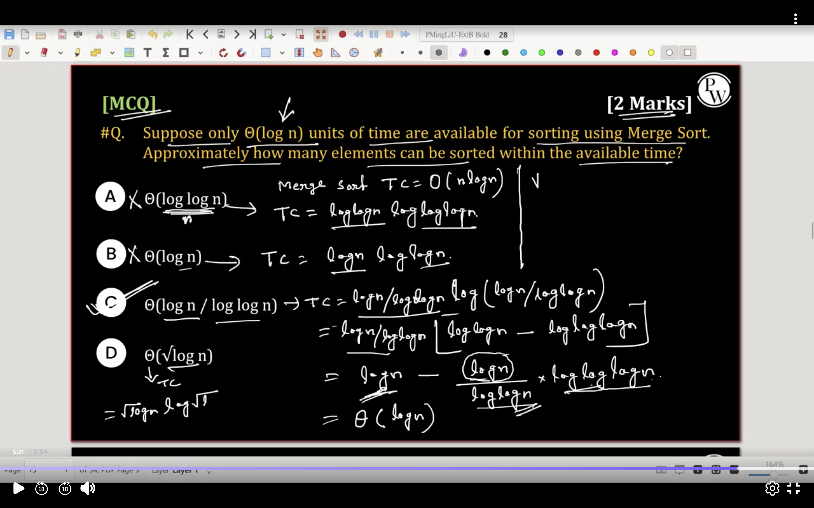

##

## Two algorithms, P and Q, are available to solve a problem. The size of input is \(n = 10^d\) records. Algorithm P requires \(0.0005 \times n^2\) units of time, and Algorithm Q requires \(10n \times \log_{10}(n)\) units of time. Determine the smallest value of \(d\) for which Algorithm Q becomes faster than Algorithm P.
---

- T(n) = C. n logn
- find C and use in 2nd eq.

##