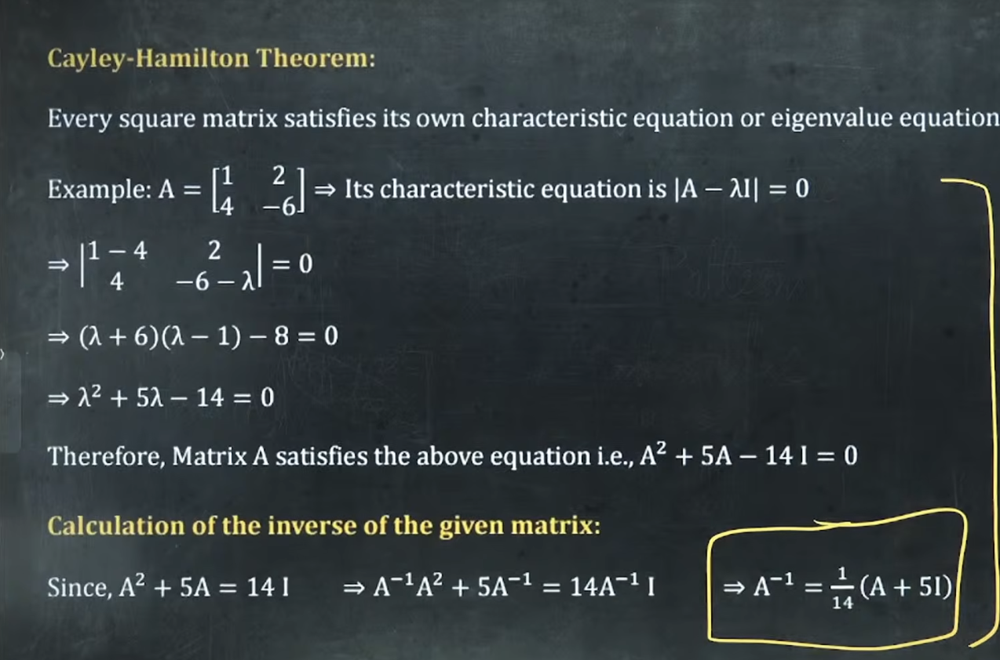

# MATRICES : 

## Types of Matrix 

> Symmetric: A^T=A
- Skew-symmetric: A^T=-A
    - if A is skew-symmetric 
        - and n is odd, then |A|^n=0 and A^n is skew-symmetric.
        - and n is even then |A^n| is Perfect square and A^n is symmetric. 
- Singular: det(A)=0
- Non-singular: det(A)!=0
- Idempotent: A^2=A
    => A - A^2 = 0.
>    => A(A-I)=0 => lamda( eigen values ) = 0 , 1
- Involutory: A^2=I
- Nilpotent: A^k=0 for some positive integer k.
    - All eigen values are zero.
> Orthogonal: A^T.A=I
    => A^T = A^-1.
    => if A is orthogonal, then |A|=1.

## Properties :
1. (AB)C=A(BC)

2. (AB)^T = B^T . A^T

3. For any square matrix \(A\):
> A =  (A+A^T) / 2 + (A-A^T) / 2

4. (AB)^-1=B^-1 . A^-1

5. A+A` , A.A^t , A^t , A^n = symmetric
   A-A` = skew sym
 

##  Trace 
is the sum of the diagonal elements of a square matrix.

### Properties :
1. Tr(A+B) = Tr(A)+Tr(B).

2. Tr(kA) = k. Tr(A)

3. tr(AB) = tr(BA)

## Rank :
-  The rank of a matrix is the maximum number of linearly independent rows or columns.
> Equivalent definition: rank is the order of the largest nonzero minor.
- For an  m * n matrix,
rank(A) = min(m,n)
- det A !=0 => rank = n

### PROPERTIES :
1. Maximum rank	     :   rank(A) <= min(m,n)
2. Product upper bound	 : rank(AB) = min (rank(A), rank(B))
3. rank(A^T)=rank(A)

## Transpose :
1. A^t^t = A.
2. (kA)^t = k. A^t
3. (AB)^t = B^tA^t
4. tr(A^t) = tr(A).
5. |A^t| = |A|

## Eigenvalues and eigenvectors

1. Characteristic equation
For a square matrix \(A\), the eigenvalues satisfy
> det( A-lambda.I ) = 0
An eigenvector X!=0 satisfies
- if matrix and its eigenvector `direction` is given use below:
    - AX=lambda.X. 
> A- (lambda I) X = 0 
- its characteristic equation is
> lambda^2-(a+d)lambda+(ad-bc)=0
> l^3 - trace.l^2 + [M11 + M22 + M33]l - |A| = 0. 
- Therefore,
    - lambda_1 + lambda_2={tr}(A)
    - lambda_1 * lambda_2= det(A)

2. if eigen values of A are 1,2,3 then eigen of 
    1. A+I will be 1+1,2+1,3+1.
    2. A^n will ne 1^n , 2^n ...
    ie Eigen values of (A^n) = (Eigen values of A)^n

3. For a upper triangular matrix , eigen values are Diagonal elements,  including repetitions.

4. A matrix is diagonalizable if it has n `linearly independent eigenvectors`. 
- `Distinct eigenvalues` always have linearly independent corresponding eigenvectors, but repeated eigenvalues require further checking.

5. Eigen values of skew symm matrix are 0 or imaginary.

6. Eigen values of orthogonal matrix are unit modulus.

7. Eigen values of Idempotent matrix are zero or unity.

## Adjoint 
- swap diagonals elements and -ve rest 2 diag els for 2*2 matrix.
- adj A = Transpose of Co Factors 
- Co fator -1^(i+j) * Minor
- Minor = | remove row and col |

### Properties :

1. |Adj A| = |A|^n-1

2. | Adj (Adj A) | = |A|^n-2

3. Adj (Adj A) = |A|^n-2. A 

## Inverse :

### Props :
1. |A^-1| = |A|^-1

2. A^-1^t = A^t^-1

3. (ABC)^-1 = C^-1.B^-1.A^-1 =====>>> SAME AS TRANSPOSE PROP

4. (K.A)^-1 = 1/K. A^-1

5. A^-1^-1 = A.

# Determenenet

## Prrops of deter
- 3*3 matrix =>
> |A|=a(ei-fh)-b(di-fg)+c(dh-eg)
- expand along row or col with + , - , + 

2. |K.A| = K^n . |A|

3. |A^T|=|A|.

4. |A^n| = |A|^n.

5. |diag(a,b,c)| = a*b*c
- similarly for triangular matrix.

6. 

## Cayley Hamilton Theorem :

 