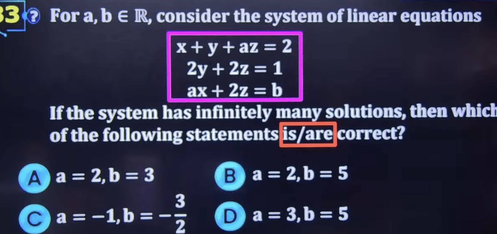
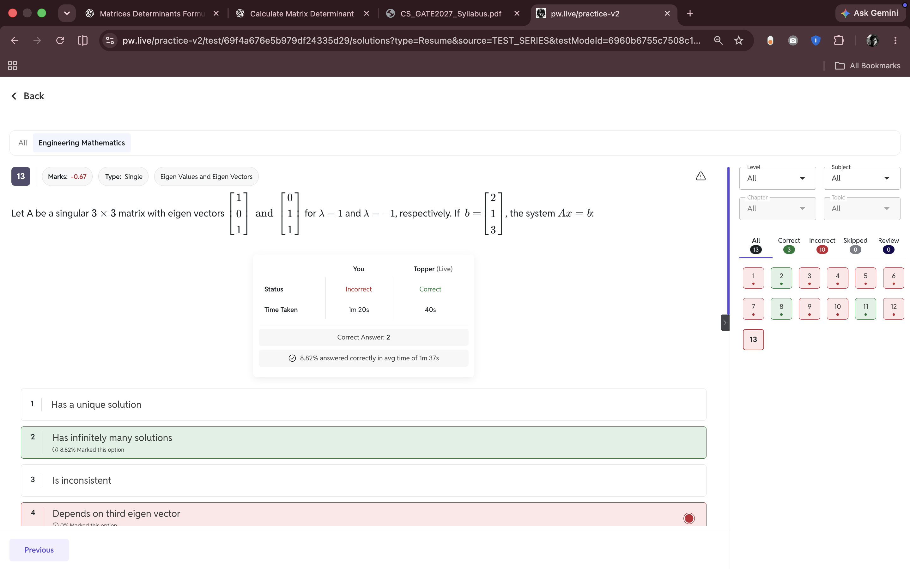

#

##
1. e^i0 + e^-i0 = 2 cos0.

2. A^-1 * A^-1 = A^-2.

## QUESTIONS 

1. 

- Make the Augmented matrix , do transpositions and make one row = 0.

2. 
> Algebraic multiplicity is the number of times an eigenvalue appears as a root of the characteristic polynomial.
- A \(3\times3\) matrix can have one eigenvalue with AM 3, or one with AM 2 and another with AM 1, or three distinct eigenvalues.

-    Condition	                     Conclusion
    - det(A)=0	                        Singular matrix
    - det(A)\ne0	                  Non-singular matrix
    - At least one eigenvalue = 0	        Singular matrix
    - All eigenvalues non-zero	        Non-singular matrix

### to do 

1. Cayley hamiltopn theorem.

2. 

