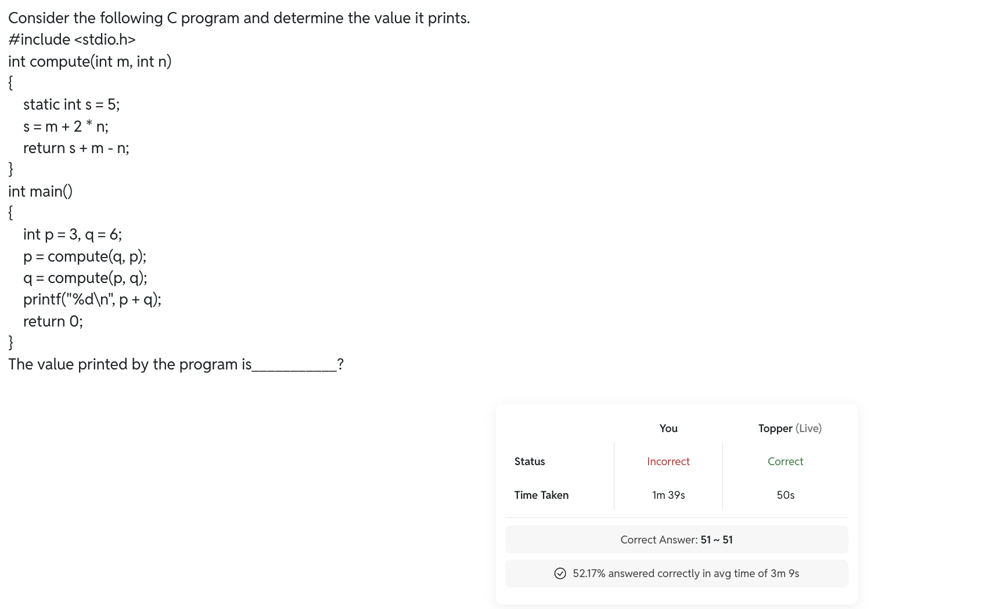
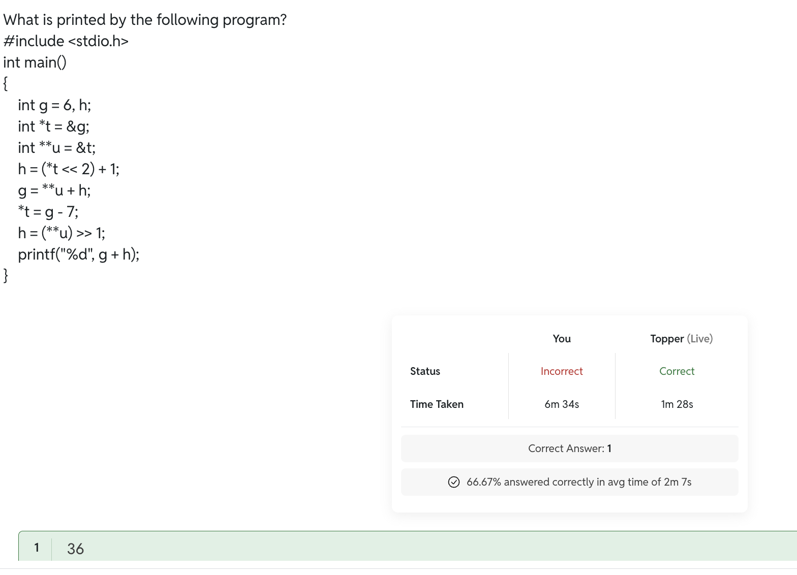
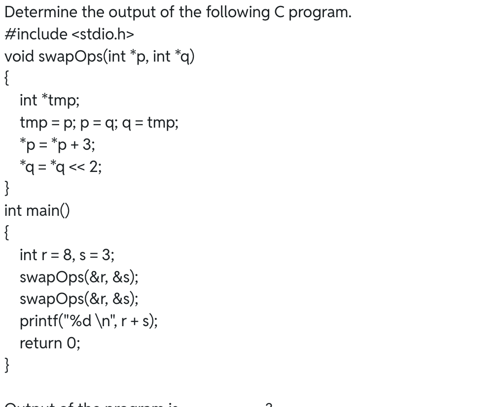
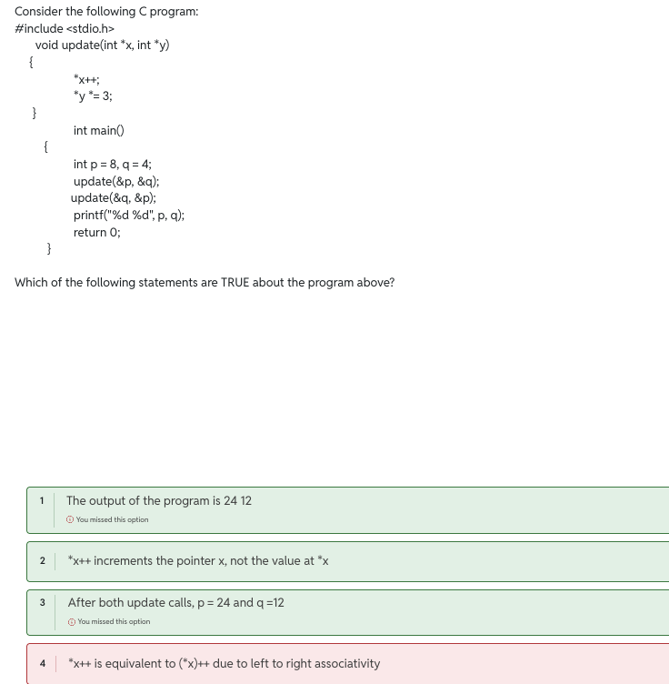

#

## 
> 2^16 = 32768.

> C standard doesnt specify the sizes of data types rather compiler does.

> In case of short , signed as well as int is optional for declaration.

## Test series pw C Prog :
1. Yes, you can use a negative number as the first operand of the modulo operator (%) in C.

2. - A static local variable retains its value between function calls.
- A static variable can still be overwritten by an assignment.
- C passes function arguments by value.

3. grid[i][j] = *(*(grid + i) + j);
| Expression              | Meaning                         |
| `grid`                  | Pointer to the first row        |
| `*grid`                 | First row of the array          |
| `**grid`                | Value of the first element: `2` |
| `grid + 1`              | Pointer to the second row       |
| `*(grid + 1)`           | Second row of the array         |
| `*(*(grid + i) + j)`    | Element at row `i`, column `j`  |
| `*(grid + i)` | Row `i` |

## RE ATTEMPT 

