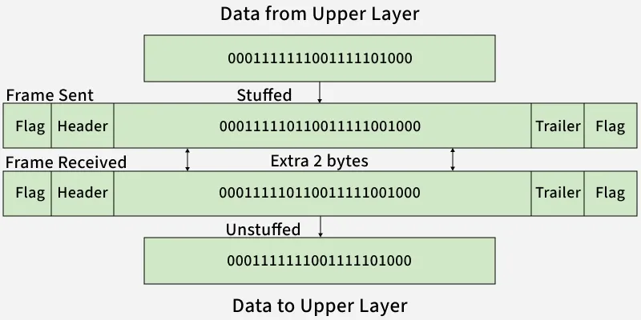

# Data Link

1. Hop to Hop Delivery 
- i.e to which router or node on network layer and other layers packet goes.

2. Flow Control :
- control speed
    1. Stop n Wait
    2. Go Back n
    3. Selective Repeat

3. Error Control from hop to hop
- CRC , Checksum , Parity.

4. Acesses Control :
who send when.
- CSMA/CD , ALOHA , Tosem

### Stop n Wait
> Send Frame 0 , wait , Receive Ack 1 , Send Frame 1 , Receive Ack 0 ... so on.

1. Sender window size = 1.
2. Reciever window size = 1.

- If Ack or Frame is lost i between , it waits TimeOut Restart time and sends again the same frame.

> Efficency = 1/(1+2x)
- x = Tp/Tt
- or Efficency = Total time / (Total time +  2*Propagation Delay)
ie Tt/(Tt+Tp)

## Go-Back-N ARQ (Automatic Repeat Request) 
1. Sequence number bits  :  m 
or m is no of bits to represent window size
2. Maximum sender window : 2^m - 1 
3. Receiver window : 1 
4. Type : Sliding-window protocol 
5. ACK type : `Cumulative ACK`
6. Out-of-order frames : Discarded 
i.e On frame loss => Retransmit from the missing frame onward.

> Efficency = (2^m-1) * 1/(1+2x)

## Selective Repeat ARQ 
1.  Sender window : 2^(m-1)
    Reciever window : 2^(m-1)
2. Out-of-order frames : Accepted 
- Retransmit = O(1) 
3. ACK type : Cumulative Ack , Independent Ack and `Neg ACK`
- Neg ACK is used to save TimeOut Restart time.

> Efficency = (2^(m-1)) * 1/(1+2x)

## Framing in Data Link Layer :

1.  Character/Byte Stuffing
- Used when data is character-based.

2. (b) Bit Stuffing

- Example Problem: Data = 011100011110, ED = 0111, After bit stuffing -> 011010001101100.
> whenever ED appears in data , append new bit at the last bit...

## Error Detection and Correction :
- Based on redundunt bits ie send more or extra bits.

### Error Detection
1. Single Bit Parity
- Even Parity : no of 1's should be even.
- detects all single bit errors
- can detect all `odd` no of errors also.
> detects d-1 errors 
d = Minimum Hamming Distance 
- The minimum Hamming distance is the smallest number of bit positions in which any two distinct valid codewords differ.
