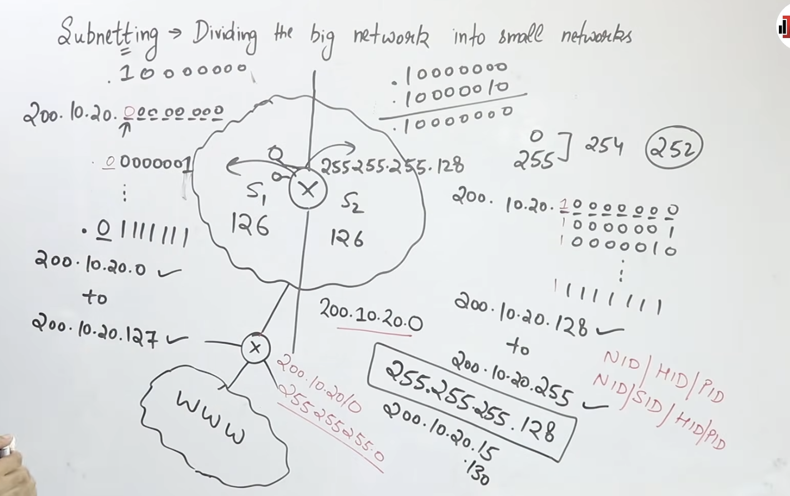
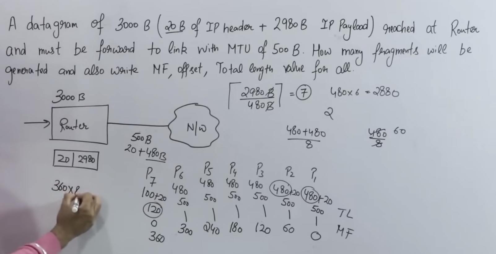

# 

## CIDR Notation OR CIDR (Classless Inter-Domain Routing)
- CIDR (Classless Inter-Domain Routing) allocates IP addresses using a variable-length network prefix instead of fixed Class A, B, and C boundaries.
- Example: 192.168.1.0/26 means the first 26 bits are the network prefix.

### 
1. Mask is all bits 1's n times.
2. Network Id = Mask & any IP.

## Sub Netting :
- Subnetting is the process of dividing a larger IP network into smaller networks by borrowing bits from the host portion.

> sub net mask is used inside the subnet router , whcih has obv extra 1.


## VLSM 
- VLSM (Variable Length Subnet Masking): Dividing a network into subnets of different sizes by using different prefix lengths.


## IPv4 Header Format 
- IPv4 Header Format
```yml
| Version(4) | IHL 4  | DSCP/ECN 8 |     Total Length 16          |
| Identification 16                | Flags 3 | Fragment Offset 13 |
| TTL 8      |          Protocol 8 | Header Checksum 16           |
| Source IP 32 bits                                               | 
| Destination IP 32 bits                                          |
| Options + Padding 0–40 bytes                                    | 
```
1. Header size = 20 - 60 Bytes
2. Payload size = 0 - 65515 (65475 if 60 Bytes Header)
> Total size = 65515+20 = 65535 (2^16-1)

3. IHL = Header length 
> Range = 0-15 wrt 0-60 Header length 
Header length is multiple of 4

4. DSCP/ECN : Type of service 

5. Total Length : Entire IP packet, header + data
2^16

6. Identification : Identifies fragments of a datagram

7. Flags :	Controls fragmentation

8. Fragment Offset	: Fragment position, measured in 8-byte units

8. TTL :  Limits packet lifetime; reduced at each router

9. Protocol : Identifies upper-layer protocol (TCP = 6, UDP = 17, ICMP = 1)

10. Header Checksum : Error check for the IPv4 header only

## Fragmentation(MTU) of IPv4 Datagram
- Fragmentation occurs when an IPv4 d atagram is larger than the Maximum Transmission Unit (MTU) of the outgoing network.

```yml
| Identification 16                | Flags 3 | Fragment Offset 13 |
```

1. Flags 
```yml
| Res | DF | MF |
```
- 
    1. Res : Reserve
    2. DF : Dont Fragment
    3. MF : More Fragment 
        - MF=1 => More Fragment follow
        - MF=0 => Last fragment, or an unfragmented datagram




## Options + Padding 
- Record Route.
- Source Routing
    - Strict Source Route.
    - Loose Source Route.
- Padding ie Multiple of 4.


